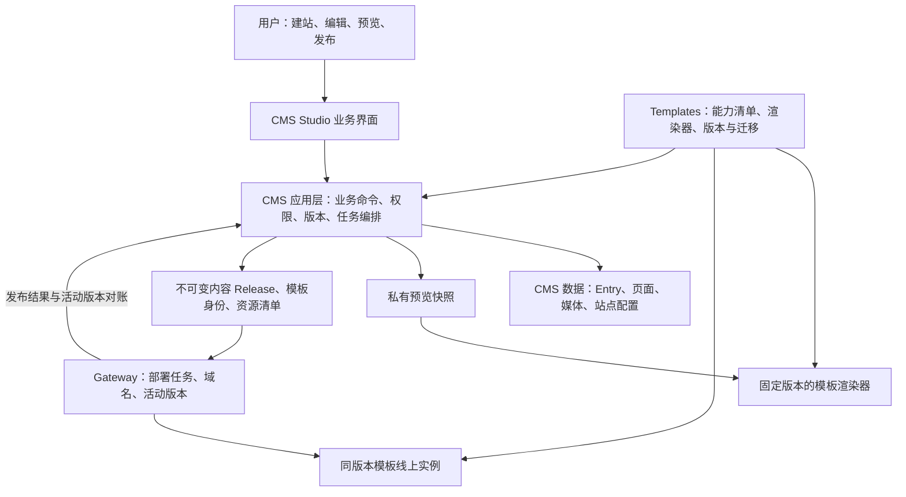

# CMS Studio 原型与 CMS / Gateway / Templates 差距分析

日期：2026-10-28。本文基于本地当前源码：CMS `b62bb88`、Gateway `5797798`、Templates `a8c3768`，同时检查当前未提交的原型和预览代码。模板主要核对 AeroFrame 1.0.2，并确认 1.0.1 存在相同的路径推断、主题丢弃和固定区块渲染逻辑。Templates README 记录的活动站点仍固定在 1.0.1；仓库发布 1.0.2 不代表站点已升级。

证据范围：源码审查、模板读取函数最小复现，以及现有渲染数据测试。没有查询当前生产数据库、重做服务器部署或执行完整跨服务验收。文中分别说明已确认事实、由调用链推导的风险和建议能力。

## 1. 总体判断

**原型的操作方向可落地；三件套具备内容管理与安全发布的基础，但尚未完整支撑原型呈现的自助建站体验。**

缺口分三类：

1. **已有能力缺少业务整合。** 商品、页面、媒体、工作区、成员权限、草稿、基础 SEO 已有底层实现，需要按用户任务组织为简单入口。
2. **跨系统协议与状态不完整。** 站点开通、模板能力、预览一致性、发布历史、媒体保留、域名接通，需要补充持久化记录、接口和任务编排。
3. **产品范围尚未包含。** 在线交易、计费套餐、通用自由搭建、多主机高可用等，需要单独确定产品目标，不能视为换一套界面就能获得的能力。

因此，不建议推翻三件套。建议在 CMS 内增加面向业务操作的应用层，并完善 CMS 与 Gateway、Template 的边界协议。初期无需再增加一个独立部署的“第四服务”。

## 2. 原型真实实现了什么

当前原型实现了前端交互：工作台、站点切换、商品和页面编辑、未保存提示、素材选择、桌面/手机预览、发布前检查、发布进度及演示历史。

但其数据保存在浏览器 `localStorage`；发布通过三次定时等待模拟，再将 `items` 复制到 `live`。创建站点也只是创建本地对象。品牌、域名、模板名称没有真实开通资源或绑定运行容器。

原型将不同对象压缩为统一 `Item`：标题、路径、副标题、正文、单图、价格、分类和导航开关。真实 CMS 则使用内容模型、Entry、媒体引用、PageDraft、站点设置及模板安装记录。两者不能直接按同名字段对接。

具体例子：

- 原型商品 `category` 是字符串；实际 CMS 有独立 Collection 及商品引用关系。
- 原型统一 `image`；实际商品支持图片数组，首页主图、内容页封面又是不同字段。
- 原型 `body` 是文本；实际内容页可用富文本，简化编辑器必须避免将既有富文本结构覆盖丢失。
- 原型根据中文标题生成 Unicode 路径；当前 PageDraft 新建规则要求小写 ASCII 路径。
- 原型展示“自然留白”“极简黑白”；独立公开模板接入目前只允许 AeroFrame，不能将演示选项直接作为真实可用模板。

落地方式：建立按内容类型映射的业务视图，复用真实数据模型，并保留必要的高级编辑入口；不能将原型的 `Item` 直接变成新的权威数据表。

证据：[原型状态与持久化](/Users/445101599qq.com/Projects/cms/ui/prototype/Prototype.vue:6)、[模拟发布](/Users/445101599qq.com/Projects/cms/ui/prototype/Prototype.vue:116)、[真实内容模型](/Users/445101599qq.com/Projects/cms/backend/src/presets/catalog.ts:64)、[页面约束](/Users/445101599qq.com/Projects/cms/backend/src/presets/pages.ts:61)。

## 3. 按用户操作对比

| 用户希望完成的任务 | 三件套当前实现 | 差距性质 | 建议补足方式 |
|---|---|---|---|
| 创建并切换网站 | CMS 支持工作区、多站点及上下文切换 | 创建内容空间与开通公网运行资源未贯通 | 每站点绑定记录、Gateway 资源开通接口、可恢复开通任务 |
| 选模板后立即开始编辑 | 已有模板导入、公开版本采用、固定版本与清单校验 | 独立公开接入限定 AeroFrame；演示模板选项超出此范围 | 真实模板目录、能力声明、兼容性校验和可用状态 |
| 添加商品并出现在网站 | 已有商品 Entry、图片、价格、Collection 引用 | 通用模型编辑与用户理解的商品操作不同；归类和首页展示涉及关联数据 | 商品业务表单及关联更新编排 |
| 新建页面并加入导航 | 已有 PageDraft、Entry 绑定、路径、SEO 和导航开关 | 多对象操作，无法用单次普通字段保存替代 | 页面创建命令统一创建/绑定 Entry、PageDraft 和导航，失败可恢复 |
| 上传和替换图片 | CMS 已有真实媒体管理和访问控制 | 原型用 data URL；Gateway 发布缺少媒体保留衔接 | 真实上传、稳定资源引用、发布资源清单和保留策略 |
| 保存草稿不影响线上 | 内容草稿与发布快照分离 | 原型局部数据不包含真实并发冲突、失败和权限 | 复用保存接口，增加版本冲突处理和错误定位 |
| 预览当前改动 | CMS 已有单页编辑态预览、整站草稿预览 | 原型、CMS storefront、独立 Template 存在不同渲染实现 | 同模板版本、同渲染组件、受控预览数据入口 |
| 查看待发布变化 | 本地发布已有页面增改删、导航和重定向差异 | Gateway 绑定时界面隐藏差异，比较基准仍来自本地 Release | 以实际活动发布版本为基准计算差异 |
| 检查后发布 | 已有构建校验、不可变快照、Gateway 发布任务 | 校验仅返回首条字符串问题；预检与最终发布之间仍可能有内容变化 | 结构化问题列表、字段跳转、冻结待发布快照与哈希 |
| 发布失败保留旧网站 | Gateway 已有候选健康检查、切流验证、失败恢复旧路由 | 基础能力较完整；前端要展示真实任务状态 | 复用既有任务、幂等键和修订号，不用定时动画判定成功 |
| 查看历史并恢复某一版 | CMS 本地发布有历史/审计/回滚；Gateway 保存 Release 和 Operation | Gateway 模式未提供统一历史与业务回滚入口 | 历史查询、发布者记录、按历史内容和镜像组合重新部署 |
| 绑定域名并启用 HTTPS | CMS 有所有权、DNS/HTTPS 检查及主域名；Gateway 有域名预留 | 两套域名记录与运行路由缺少统一闭环 | 单一权威绑定流程、验证结果衔接、证书和路由任务 |
| 修改品牌、颜色、区块 | CMS 有部分品牌和主题字段、固定区块配置 | 独立模板部分内容硬编码；主题和顺序未完整消费 | 模板暴露真实可编辑能力，渲染器逐项实现 |
| 获取询盘或完成交易 | 当前模板询盘按钮为 mailto；商品主要用于展示 | 询盘收件流程和交易系统未包含 | 询盘需真实提交/通知/查询；交易需另接订单支付等领域服务 |

此表中“缺少衔接”不代表所有底层能力缺失；“已有”也不代表已完成当前生产环境验收。

## 4. 优先处理的六个问题

### 4.1 Gateway 发布没有接通 CMS 媒体公开访问和保留链路

**事实：** 本地 `storefrontRelease` 写入时通过 `prepareWrite` 调用 `pinReleaseMedia`。匿名图片访问也通过本地已发布 Release 查找授权引用。Gateway 发布则将快照存入 `gatewayPublishIntent` 并上传到 Gateway，没有调用本地 Release 写入和媒体固定函数。

**由调用链推导的风险：** 一张仅经 Gateway 发布、未被本地已发布 Release 引用的 CMS 上传图片，无法借此获得匿名公开访问授权，也没有进入同一套发布保留机制。它可能在后台可见、线上匿名访问失败，或者仍可被删除。既有外部图片及已被本地发布引用的图片可能掩盖这一问题。本次未在真实存储环境做上传后匿名访问复现。

**补足：** 把资源清单与发布记录关联，并协调候选实例读取授权、正式公开授权、防误删和失败清理。更完整的方案是在发布时将资源复制为按内容哈希寻址的发布资产，避免线上图片依赖 CMS 当前运行状态。预览授权必须保持私有，不能为预览直接公开所有草稿图片。

验收：上传一张全新图片，仅通过 Gateway 发布；无登录访问可用；删除引用中的图片受保护；回滚仍可读取原图；失败发布不公开草稿资源。

证据：[媒体公开授权](/Users/445101599qq.com/Projects/cms/backend/src/media/access.ts:30)、[保留机制](/Users/445101599qq.com/Projects/cms/backend/src/media/retention.ts:8)、[本地发布写入钩子](/Users/445101599qq.com/Projects/cms/backend/src/presets/release-repo.ts:15)、[Gateway 快照提交](/Users/445101599qq.com/Projects/cms/backend/src/presets/gateway-publish.ts:169)。

### 4.2 “线上是什么版本”尚未成为 CMS 内一致的事实

**事实：** Gateway 有 `ActiveDeployment`，CMS 本地有 `currentReleaseId`。Gateway 路径更新最近一次 `gatewayPublishIntent` 的状态，没有同步生成同一套 CMS 本地发布记录。后续快照的 `previous` 仍取本地 `currentReleaseId`。Gateway 模式下，UI 隐藏差异、历史和审计，本地回滚接口明确拒绝 Gateway 站点；Gateway 发布函数的 `_actorId` 也没有记录到当前发布意图。

**影响：** 在线内容、待发布变化、发布者、历史恢复没有统一展示。连续发布时路径变更所需的旧版本比较及重定向，也不能依赖一个没有跟随 Gateway 更新的本地基准。

**补足：** CMS 持久化每次业务发布记录、操作者、冻结快照、模板身份和任务关联；Gateway 作为活动部署的权威，CMS 通过后台对账更新其投影。成功必须依据实际活动版本与任务结果，不能只依据浏览器是否轮询到 ready。回滚应重新部署目标内容 Release 与目标镜像的组合，并使用新的部署修订号。

不能仅把 `currentReleaseId` 改成 Gateway Release ID：它目前关联本地内容、媒体、历史和回滚语义，需要一并调整。

证据：[Gateway 状态读取](/Users/445101599qq.com/Projects/cms/backend/src/presets/gateway-publish.ts:225)、[本地比较基准](/Users/445101599qq.com/Projects/cms/backend/src/presets/release-controller.ts:93)、[Gateway 模式隐藏历史](/Users/445101599qq.com/Projects/cms/ui/src/components/storefront/release-manager.tsx:159)、[回滚边界](/Users/445101599qq.com/Projects/cms/backend/src/presets/release-controller.ts:135)、[活动部署模型](/Users/445101599qq.com/Projects/Independent-Website-Gateway/prisma/schema.prisma:102)。

### 4.3 多站点的数据结构已存在，自助开通仍缺一段

**事实：** CMS 的创建站点接口生成空的 `SiteInstallation`；Gateway 发布配置由一组全局环境变量给出，且严格比较当前 CMS 站点是否等于该绑定。Gateway 当前控制 API 路由包含已有站点的发布、模板、域名接口，未提供站点集合创建接口；服务认证也由单个配置的工作区身份产生。

**影响：** 原型的“创建新站点”不能自然转化为另一个可发布、可访问的独立网站。数据库支持多站点，不等于自助多站点产品链路已完成。

**补足：** 持久化 `CMS workspace/site ↔ Gateway workspace/site` 绑定；开通任务依次完成资源创建、模板安装、默认内容和默认地址准备。使用稳定幂等键、可重试步骤和补偿机制。单公司私有部署可以保留单工作区认证边界；面向多公司托管 SaaS 时，再扩展服务身份、租户授权、配额和资源隔离，不能靠前端切换参数完成隔离。

证据：[CMS 创建站点](/Users/445101599qq.com/Projects/cms/backend/src/workspaces/controller.ts:223)、[全局绑定](/Users/445101599qq.com/Projects/cms/backend/src/presets/gateway-publish.ts:37)、[绑定检查](/Users/445101599qq.com/Projects/cms/backend/src/presets/gateway-publish.ts:134)、[Gateway 服务身份](/Users/445101599qq.com/Projects/Independent-Website-Gateway/apps/control/src/auth.ts:12)。

### 4.4 有预览入口，但尚不能保证与发布效果一致

**事实：** CMS 已有 `/storefront/site-preview`，并用构建 Release 的逻辑生成草稿数据。预览页面渲染的是 CMS 仓库内 `DraftSitePreview` / `PresetDemoPage`；独立发布使用 Templates 仓库固定版本的 Nuxt 页面。原型又有自己的展示实现。

**影响：** 数据相近不等于样式、模块、导航和交互一致。用户在原型中看到的生活方式网站，也不是现有 AeroFrame 工业模板本身。

**补足：** 预览与线上使用同一模板版本和渲染组件，通过不同数据适配器读取私有草稿或已发布快照。可选择共享渲染包，或按固定镜像运行隔离预览实例。预览快照需要有效期、访问控制、noindex 和独立资源授权。

验收应覆盖全站链接、移动导航、图片、字体、主题、区块和富文本，而不是仅比较首页截图。

证据：[真实整站预览接口](/Users/445101599qq.com/Projects/cms/backend/src/storefront/controller.ts:195)、[CMS 预览组件入口](/Users/445101599qq.com/Projects/cms/storefront/app/pages/preview.vue:45)、[独立模板页面](/Users/445101599qq.com/Projects/Independent-Website-Templates/templates/aeroframe/1.0.2/storefront/pages/[[...path]].vue:1)。

### 4.5 模板“可配置”需要成为跨仓库共同承诺

已确认的限制：

- CMS 公开模板标准化函数明确只支持 AeroFrame，模型与字段匹配固定 profile。
- CMS 可保存主题字段，但独立模板读取器返回的页面数据丢弃 `preset.theme`；样式采用固定主题值。
- 区块通过 `includes()` 判断是否显示，页面结构写定；调整 sections 数组顺序不会自动重排模块。
- 页面类型由 `/`、`/collections`、`/products/` 路径推断；它不是完全由显式页面类型决定。
- Logo 标记、多个 CTA、页脚文案和部分行业说明写在模板代码中；CMS 存在某字段不意味着模板已使用它。
- SEO 已有标题、描述和语言输出；在独立模板 1.0.2 源码中未发现完整 canonical、站点地图和 robots 生成实现，不能沿用 CMS 自带 storefront 的能力判断。

最小复现结果：默认 `/collections` 的集合页被接受；相同集合页改为 `/catalog` 后，读取器拒绝整个快照；普通内容页 `/shipping` 可正常读取。因此，不能概括为“所有自定义路径都不支持”。该不兼容可能在候选首页检查阶段表现为发布失败。

建议模板清单声明：支持的内容类型、语义字段映射、主题项、区块结构和顺序、路由规则、语言、SEO 与预览能力，并提供版本兼容和迁移策略。CMS 只展示模板真正支持的配置项；需要的能力未实现时，增加明确的模板版本，而不是放宽校验后直接上线。

证据：[固定模板 profile](/Users/445101599qq.com/Projects/cms/backend/src/presets/registry.ts:65)、[固定区块选项](/Users/445101599qq.com/Projects/cms/backend/src/presets/pages.ts:5)、[路径推断与主题投影](/Users/445101599qq.com/Projects/Independent-Website-Templates/templates/aeroframe/1.0.2/storefront/server/utils/published.mjs:65)、[固定渲染结构](/Users/445101599qq.com/Projects/Independent-Website-Templates/templates/aeroframe/1.0.2/storefront/pages/[[...path]].vue:14)。

### 4.6 域名验证、证书和运行路由需要一个完整生命周期

CMS 有 TXT 所有权验证、DNS/HTTPS 检查、主域名与审计等基础。Gateway `reserveDomain` 当前完成域名预留，状态初始为 pending；worker 则选择已 verified 的域名作为代表 Host，当前路由模型每站点记录一个 host。

因此，既不能说“完全没有域名能力”，也不能把填写域名等同于域名已接通。需要补齐跨系统域名授权和同步、默认子域名、证书签发/续期、主域名切换、别名跳转及解绑流程。DNS 等待是外部异步步骤，界面应清楚显示“待解析、验证中、证书处理中、已接通、失败重试”。

证据：[CMS 域名服务](/Users/445101599qq.com/Projects/cms/backend/src/site-domains/service.ts:57)、[Gateway 域名预留](/Users/445101599qq.com/Projects/Independent-Website-Gateway/apps/control/src/domains.ts:20)、[worker 选择域名](/Users/445101599qq.com/Projects/Independent-Website-Gateway/packages/worker/src/index.ts:118)、[当前路由模型](/Users/445101599qq.com/Projects/Independent-Website-Gateway/packages/worker/src/runtime.ts:5)。

## 5. 建议保持的全局架构

职责建议：

- **CMS** 管用户内容、权限、编辑体验、业务操作和发布意图。简化界面背后的复杂步骤由 CMS 应用层承担。
- **Gateway** 管运行资源、部署执行、流量切换、域名证书和实际活动版本；不承担商品字段编辑。
- **Templates** 管可编辑能力、内容渲染、响应式和版本兼容；不各自实现一套独立后台。

需要明确的权威来源：草稿以 CMS 为准；模板可用能力以固定版本清单为准；线上部署以 Gateway 活动版本为准；域名所有权及运行绑定应有清晰单一流程；发布资源以不可变资源清单为准。其他系统保存投影并持续核对，避免两个可独立修改的“当前状态”。

建议新增的是这些概念对应的记录和接口，具体可复用既有表/集合，无需机械地新增同名实体：

| 概念 | 核心内容 |
|---|---|
| 站点绑定 | 两端站点身份、运行地址、开通状态 |
| 模板能力与编辑映射 | 模型/语义字段、页面类型、区块、主题、版本兼容 |
| 发布记录 | 操作者、内容快照与哈希、资源清单、固定模板版本和镜像 |
| 业务任务 | 幂等键、步骤状态、错误、重试与补偿信息 |
| 活动部署投影 | Gateway 当前 Release、镜像 digest、路由修订号与核对时间 |
| 结构化检查问题 | 问题代码、严重度、对象、字段、修复入口 |

跨 MongoDB、PostgreSQL 和 Docker 的步骤不宜伪装成一个数据库事务。CMS 内部写入可用实际支持的事务或原子操作；跨服务通过持久化任务、outbox、幂等接口、补偿及后台对账保证最终一致。

## 6. 实施顺序与完成标准

### P0：先闭合一个真实网站的使用流程

1. 明确首期是展示/询盘站，还是在线交易站；当前底座更接近前者。
2. 对接一个真实支持的固定模板，完成商品、页面、媒体和设置的业务视图映射。
3. 统一 Gateway 发布记录、活动版本比较、路径重定向和历史恢复；优先补媒体公开授权与保留链路。
4. 将预检结果绑定到冻结快照；发布检查后有人继续编辑时，明确发布冻结版本或要求重新检查。
5. 预览使用同版本渲染器；后端输出字段级校验问题。

完成标准：新用户不进入通用模型配置，就能修改首页、创建商品/页面、预览、发布；退出后重新登录仍能查到真实状态；全新上传图片可匿名访问；第二次发布能识别变化并保留旧路径；部署失败保留原站点；能够恢复上一发布版本。

### P1：闭合自助多站点与协作流程

补每站点 Gateway 绑定、自动开通任务、默认子域名、自定义域名/证书和受支持的模板升级流程。将已有角色权限映射到业务操作；若产品需要审核发布，再增加审批规则。

完成标准：同一工作区创建两个站点后都可独立发布，图片、内容、域名及历史不串用；刷新、重试和中途失败不会重复开通资源。托管多租户产品还须验收跨工作区拒绝访问及资源限制。

### P2：按产品形态扩展平台能力

Gateway 已有发布租约、候选清理和重启路由恢复，不能笼统说“没有恢复能力”。但单机部署验证与数据库备份步骤，也不等于跨 CMS 数据、媒体、Gateway 数据库、Release 卷和镜像依赖的完整灾备已验收。

需要按目标补监控告警、资源配额、旧实例和资源回收、备份恢复演练、容量压测；有明确可用性目标后，再决定多主机和高可用设计。

若做商业 SaaS，再增加套餐计费、租户生命周期和支持后台；若仍是每家公司私有部署，则不必把这些作为首期前置条件。若做交易站，应接入专门的订单、支付、库存与履约能力，CMS 保存展示内容及外部商品标识，避免让 CMS 承担交易一致性。

## 7. 本次验证与边界

- 运行 AeroFrame 1.0.2 `storefront/test/render.test.mjs`：7 项通过，0 失败。
- 直接调用 `publishedPage`：有效首页被接受，但返回数据没有 theme；默认集合路径被接受；重命名集合路径导致快照被拒绝；普通自定义内容页被接受。
- 源码确认 Gateway 模式的 diff/history/audit 隐藏和本地 rollback 拒绝；确认全局单站绑定及媒体保留调用链差异。
- 媒体问题为源码调用链推导，需用“全新上传、仅 Gateway 发布、无登录访问和删除尝试”做跨服务复现。
- 没有执行完整 CMS/Gateway 集成测试，没有用历史验收文档替代当前线上验证，没有修改现有业务代码或部署配置。

**最终建议：先把一个固定模板、一个真实网站的内容编辑到发布恢复做完整，再扩展多站点和模板自由度。衡量简化是否成功，应看用户能否完成真实任务，以及系统能否在刷新、并发、失败和回滚时保持正确，而不只是界面减少了多少按钮。**
