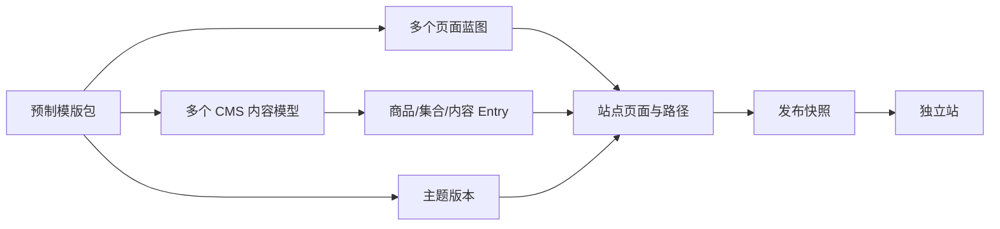

# 预制模版驱动的电商独立站解决方案

> 状态：阶段 A、B、C 已实现，2026-10-23。阶段 C 的发布、正式路由、增量加页及回滚已通过本地验收；部署验收见 `docs/verification/storefront-phase-c.md`。

## 阶段 A 落地范围

当前代码内置 Atelier 和 Market 两套版本化预制包。管理端 `/d/presets` 支持整站演示视图、桌面/手机切换、导入差异预检、可选示例文本 Entry 和建站清单。导入记录固定占用一个站点槽位，生成商品、集合、首页、内容页、站点设置五种 CMS Template 与字段映射，以及四条草稿页面定义；重复导入复用记录，写入中断后可重试。管理员可沿清单打开生成模型并创建 Entry。

演示图片引用外部资源，只参与预览，不导入 CMS 媒体库。现有商品详情页及其预览功能保持原有行为。导入完成不代表独立站已发布。

## 阶段 B 落地范围

管理员可在 `/d/presets` 调整四种页面草稿的标题、路径、SEO 和可选区块，并为首页绑定固定 Entry。校验会阻止页面蓝图之间的路径冲突及对应用保留路径的占用。旧安装记录在读取时补齐这些新增属性，无需重新导入。已有模板读取权限的编辑者可在 Entry 编辑器中点击“预览页面”，选择适用页面和桌面/手机视口；预览 API 映射当前未保存字段、语言、关联 Entry 和 CMS 图片，使用导入主题渲染，不写入 Entry。预览 iframe 校验消息来源，响应禁止缓存和索引。

导入页面默认全为草稿，首次发布前公开 URL 返回 404。阶段 C 发布后，首页、集合、商品及内容页均只读取当前 Release；已安装预制包的站点关闭旧商品直出接口。保存 Entry 或页面配置不会改变已发布内容。

## 阶段 C 落地范围

管理员可复用已安装蓝图新增固定页面，绑定 Entry，配置 SEO、区块、导航和下次发布是否包含该页。发布前校验模型映射、必填内容、媒体、路由、导航与内链，并展示新增、修改、下线和重定向差异。发布先保存不可变渲染快照，再以 MongoDB CAS 切换站点指针；失败保留原公开版本，历史版本支持回滚及操作记录。

Nuxt 通用路由、导航、canonical 和 sitemap 只读取当前快照；路径修改生成 301，页面 HTML 和查询使用 no-store。当前限单站点、配置的一种语言和一个域名，主题迁移和 CDN 清理适配器后续交付。

## 1. 目标与关键决策

用户先在模版库中预览整站布局及主题效果，选择一套预制模版包导入站点。系统据此创建内容模型和字段、页面蓝图及站点配置。用户随后创建 Entry，编辑时通过“预览页面”按钮查看未保存内容在目标页面中的实际效果；发布后仍可新增页面、修改内容和回滚。

**一套预制模版包不等于一个 CMS Template。** 一个电商站包含多种内容和页面。一套包应提供统一主题、共用页头页脚、多个页面蓝图、多个 CMS 内容模型及一份建站清单。CMS Template 只定义某一类 Entry 的字段。预览图展示布局，颜色、字体、间距等主题设置同时参与真实渲染。

首期聚焦建站与内容展示。购物车、结账、支付、订单、库存属于交易系统；商品展示价格在接入交易系统后应以交易服务的价格为准，避免展示与结账不一致。

## 2. 与当前代码的关系

| 已有能力 | 当前边界 | 后续用途 |
| --- | --- | --- |
| `backend/src/template/models/main.ts` 的 Template/Prop | 定义字段，未关联站点或预制包 | 复用为内容模型；补充站点归属和导入来源记录 |
| `backend/src/entry/models/main.ts` 的 Entry | 存储各语言的字段值、内容和状态 | 继续作为商品、集合、普通页面等内容实例 |
| `backend/src/storefront/setup.ts` | 启动时按名称创建单一 `product` 模型 | 改为显式、可校验、幂等的整站预制包导入 |
| `backend/src/storefront/model.ts` | 仅接受商品详情页 v1 配置及固定区块 | 扩展为按页面类型校验的版本化页面蓝图 |
| `ui/src/components/storefront/product-preview.tsx` | 商品编辑时自动显示预览，未保存内容经 API 映射后发给 iframe | 扩展为通用的“预览页面”按钮和页面选择器 |
| `storefront/app/pages/products/[slug].vue` | 仅实现商品详情路由 | 加入整站路由解析、主题布局和各页面渲染 |

最初开发原型仅有商品详情页，未安装预制包时保留该兼容流程；安装后公开内容由 Release 决定。Entry 状态选择器仍用于编辑协作，公开可见性以站点发布指针及不可变快照为准。

## 3. 领域模型

| 对象 | 责任 | 生命周期 |
| --- | --- | --- |
| `PresetPackage` | 平台维护的整站预制包；包含预览数据、主题版本、内容模型定义、页面蓝图和建站清单 | 不可变版本，可升级 |
| `ThemeVersion` | 颜色、字体、间距、组件样式、区块注册表及配置 schema | 平台发布版本；站点固定引用 |
| `Site` | 站点身份、语言、域名、主题设置、当前发布指针 | 商家创建，长期存在 |
| `ContentTemplate` | 对应现有 CMS Template；定义商品、集合、普通页面等 Entry 字段 | 导入后成为站点可管理的模型 |
| `Entry` | 具体内容，按语言保存字段值 | 草稿、已发布、归档 |
| `Page` | 稳定的页面 ID、页面类型、路径、SEO、区块配置和内容绑定 | 可独立创建、编辑、下线 |
| `Release` | 主题版本、页面配置、导航和所需内容版本的不可变快照 | 发布后不可修改，可回滚 |

新增对象必须以 `siteId` 作为服务端校验的归属边界。现有 Template/Entry 仓储主要是实例级数据，不能仅靠前端传入 `siteId` 实现多站点隔离。若首期仍只允许一个站点，也应在接口与数据模型中保留站点边界。



## 4. 预制包内容与整站覆盖

预制包由平台维护，建议使用版本化 manifest 与受控 Nuxt 组件注册表。manifest 只描述结构和配置，不上传或执行商家代码。导入时把包内稳定键映射成该站点的实际 Template、Prop、Page 和 Entry ID；页面字段绑定保存实际 Prop ID，升级依据稳定键重新校验和迁移。

```json
{
  "id": "modern-commerce",
  "version": "1.0.0",
  "schemaVersion": 1,
  "theme": { "id": "modern-commerce", "version": "1.0.0", "tokens": { "color.primary": "#156F5B" } },
  "contentModels": ["product", "collection", "content-page", "site-settings"],
  "pageBlueprints": ["home", "collection-list", "collection-detail", "product-detail", "content-page"],
  "sharedRegions": ["header", "footer"],
  "seedContent": "optional-demo-data"
}
```

上例是概念合同，不是现有接口格式。实际 manifest 还需声明每个字段的类型、必填规则、默认值、可用区块、绑定关系、支持语言、兼容版本与媒体资源校验和。

| 页面或内容 | 预制件提供什么 | 用户维护什么 |
| --- | --- | --- |
| 全站页头、页脚、导航 | 主题组件、默认结构及导航入口 | Logo、菜单、公告、联系信息 |
| 首页 | Hero、精选商品、集合入口、品牌介绍等区块蓝图 | 文案、图片、精选对象、区块排序 |
| 商品集合页 | 列表和详情布局、筛选/排序容器 | 集合名称、描述、封面、商品关联 |
| 商品详情页 | 图集、价格、描述、关联商品布局 | 商品 Entry；交易动作接交易服务 |
| 通用内容页 | 富文本、图文、FAQ 等受控区块 | 关于我们、配送、退换货等页面 |
| 搜索、404、隐私与条款 | 默认布局和最低必需页面清单 | 搜索数据源、政策正文和 SEO 信息 |

“一套模版构建整站”的含义是视觉系统、页面蓝图和内容模型成套交付，不是所有页面共用同一组字段。商品可有多个 Entry 并共用详情页蓝图；“关于我们”等普通页面可用同一 `content-page` 模型创建不同 Entry 和路径。首页、导航等单例内容可用 `singleEntry` 或站点设置承载。购物车和结账页面可沿用主题外观，但交易状态和安全逻辑必须由交易系统处理。

## 5. 用户流程

### 5.1 选模版与预览

模版库按行业、风格和可用页面类型筛选。每个包有完整的演示站，用户可切换桌面/手机视口，查看首页、集合页、商品页及内容页。预览使用同一版 `ThemeVersion`、页面蓝图和演示 Entry 渲染，显示颜色、字体及布局；颜色切换仅作为主题变体预览，不改变真实站点。

模版详情明确列出包含的页面、内容模型、可调节项和不包含的交易能力。选择后进入导入确认页，展示将新增或复用的模型、页面与演示数据，并允许选择“空内容”或“附带示例内容”。

### 5.2 导入与生成属性

1. 服务端检查预制包版本、目标站点权限、字段类型和命名冲突，生成导入预览差异；用户确认后再执行。
2. 为每个内容模型创建或按稳定键复用 CMS Template，并生成 Prop。保留 `presetId`、`presetVersion`、`modelKey`、`fieldKey -> propId` 映射，避免依赖中文标签或可改的显示名称。
3. 创建站点、主题设置、共用页头页脚、页面蓝图、默认路径和导航草稿。按选择导入示例 Entry 与媒体，并记录其为示例数据。
4. 将导入过程作为一个可恢复的作业：每步记录结果；失败时回滚本次新增对象或继续重试，不留下半成品站点。重复点击导入必须返回同一作业/结果。
5. 导入成功后进入建站清单：品牌信息、商品、集合、首页内容、政策页、导航、域名、预览、发布。每项直接跳转到对应编辑页面，并根据必填校验显示完成状态。

导入后的字段可以扩展；删除或更改已绑定字段前，要显示受影响页面和 Entry，阻止破坏性变更直至完成迁移。主题升级只修改显式兼容的默认值，保留商家已覆盖的设置。

### 5.3 创建 Entry 与实时预览

用户从建站清单或内容列表进入某类 CMS Template，填写其自动生成的属性后创建 Entry。编辑页提供“预览页面”按钮；一个 Entry 对应多个展示位置时，先选目标页面或使用场景。预览抽屉可切换视口和语言，并标注“草稿预览”。

按钮打开后，编辑器将当前未保存的 Entry 和页面草稿发送到经鉴权的预览 API。API 按站点、语言、页面类型校验字段绑定并组装页面视图模型；Storefront 继续使用正式页面的主题组件渲染。打开期间对输入变更做节流更新，旧请求结果不得覆盖新内容。未创建的 Entry 也能预览，但必须给它临时上下文和可预见的目标路径。关闭预览不保存内容。

现有商品预览链路可以复用其 API 映射、`postMessage` 来源校验和 iframe 渲染模式。通用预览还要处理关联 Entry、导航和页面草稿；共享预览链接则使用短时、只读、限站点/页面/语言的令牌。预览响应设置 `no-store`、`noindex`，不向浏览器暴露长期 CMS 凭据。

## 6. 发布、加页和长期维护

正式站点只读取 `Release` 指向的已发布数据。首次发布检查必需页面、字段、媒体、路由冲突、站点导航、SEO 信息及主题兼容性，生成不可变快照，再原子切换站点发布指针。失败仍保留上一版可访问；支持查看差异与回滚。`Entry.statuses` 可继续服务编辑协作，但公开可见性以发布快照为准。

发布后新增页面的完整流程是：选择已安装模版包支持的页面蓝图或通用内容页蓝图 -> 填写页面路径和 SEO -> 创建/绑定 Entry -> 草稿预览 -> 检查路由与导航 -> 发布一个新的 Release。无需重新导入整套模版，也无需手工改 Nuxt 路由源码。新增页面先保持草稿状态；发布后更新路由索引、站点地图和受影响缓存。页面路径修改要建立旧路径重定向；下线页面时检查导航、内链和关联内容。

日常维护分成三类：内容编辑（商品、集合、文案、图片）、站点配置（导航、主题 token、页面区块及 SEO）、平台维护（主题版本和组件）。内容变更按站点权限审核和发布；主题升级先在草稿环境做兼容校验及页面差异预览，确认后发布。保留发布历史、操作者、失败原因、备份和恢复记录。商品价格与库存如由交易服务管理，应走独立数据更新路径并明确页面缓存时效。

## 7. 建议交付顺序与验收

| 阶段 | 交付 | 核心验收 |
| --- | --- | --- |
| A. 整站模版导入 | 版本化预制包、模版库、演示预览、导入作业、内容模型与建站清单 | 新站点一次导入获得首页、商品、集合、通用页模型和默认页面；重复导入无重复对象；失败可恢复 |
| B. 页面与通用预览 | Page/区块草稿配置、Entry 预览按钮、视口/语言切换 | 未保存的商品和普通页面内容能预览；错误绑定被拒绝；草稿不公开 |
| C. 发布与加页 | Release、通用公开路由、发布校验、增量加页、重定向、回滚 | 公开路由只读 Release；发布后新增页面可访问并进入导航/站点地图；回滚恢复上一版 |
| D. 运营扩展 | 多站点/域名、主题升级迁移、缓存失效、监控与权限细化 | 站点数据隔离、升级保留覆盖配置、发布失败可定位和恢复 |

优先完成 A 的“一个包覆盖完整内容结构”，再扩展更多主题。首个包可只提供一种视觉主题和几种颜色变体，但页面蓝图必须覆盖基本整站信息架构，否则用户仍需手工设计网站。

## 8. 需要确认的产品边界

当前默认假设是平台维护预制包和主题代码，商家只能修改受控配置；每个站点安装一套主主题，但可以在页面级选择布局变体；首期不提供任意代码上传。若目标是开放第三方主题市场、支持任意商家脚本或让 CMS 承担交易核心，需要另立安全、构建和业务模型方案。

本方案承接 `docs/architecture/storefront-platform.md`，具体落地前应先确认交易系统来源、首期是否多站点、语言范围，以及域名发布的优先级。这些决策不改变上述“预制包 -> 内容模型/页面 -> Entry -> 预览 -> Release”的主流程。
