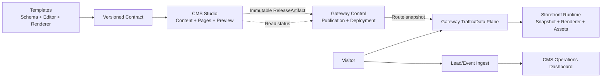

# 建站与内容维护平台 RoadMap

日期：2026-11-01

## 目标

把当前已经跑通的“模板预览、CMS 编辑、Gateway 发布、Storefront 渲染”链路，演进为可持续交付的建站与内容维护平台：

- 模板通过版本化契约定义内容模型、页面蓝图、编辑控件和渲染能力。
- CMS Studio 提供内容、页面、区块、导航、SEO 和站点设置维护。
- Gateway 负责发布请求、活动版本、域名、部署和流量状态。
- Storefront 只读取不可变发布产物并提供公开网站访问。
- CMS 或 Gateway control 故障不影响已经上线的网站。
- 询盘和访问数据通过独立事件链路进入 CMS 看板。

本 RoadMap 以“单站点可用 MVP → 多站点运营平台 → 可扩展模板平台”为演进路径，不把支付、订单、库存和物流混入建站能力。

## 当前基线

截至 2026-11-01，以下能力已经在隔离 Docker 环境完成验证：

- ContractSnapshotV1 roundtrip。
- Gateway 发布、恢复和实例退役。
- 模板渲染和只读发布快照挂载。
- CMS Studio 首页字段编辑、草稿保存、整站预览和发布。
- Gateway control 停止后，已有网站仍可访问。

证据见 [`2026-11-01-docker-e2e-closure.md`](../verification/2026-11-01-docker-e2e-closure.md)。

当前仍存在的关键缺口：

- 隔离 artifact 运行时已经可以脱离 CMS 提供页面、资源、重定向和 sitemap；隔离 Compose 的内置站点仍保留显式 CMS 兼容开关，待逐站点迁移后关闭。
- Gateway 状态模型和 CMS 状态投影还需要进一步收敛。
- Studio 深度编辑能力尚未逐项验收。
- P5.1 询盘已形成 Gateway 权威接收、CMS 投影和模板表单闭环；P5.2 已完成访问事件、基础聚合、事件幂等、保留清理和跨站点 Docker E2E；P6.1 已完成请求级 workspace/site 校验、站点能力边界和内容隔离回归；P6.2 已实现 Gateway 域名状态投影、primary/alias 路由、未知 Host fail closed、301 保留和失败回滚，待修复现有 Docker gateway-e2e 的认证 fixture 后完成环境级验收，再进入 P6.3 旧站点迁移和灰度。

## 目标架构



边界规则：

| 组件 | 核心职责 | 线上请求依赖 |
| --- | --- | --- |
| Templates | 契约、编辑 schema、页面蓝图、渲染器 | 不依赖 CMS 或 Gateway control |
| CMS | 草稿、Studio、预览、发布请求、状态展示、运营看板 | 不在公开页面请求路径上 |
| Gateway control | 发布、部署、域名、活动版本、回滚 | 不承担 CMS 草稿读写 |
| Gateway traffic/data plane | 路由、转发、发布产物读取 | 只依赖路由快照和运行实例 |
| Storefront | 页面渲染、SEO、导航、公开资源 | 不调用 CMS 编辑接口或 Gateway control |

## 里程碑总览

| 里程碑 | 目标 | 主要交付 | 退出条件 |
| --- | --- | --- | --- |
| M0 | 契约与观测基线 | ContractSnapshotV1、兼容投影、跨仓 fixture、指标基线 | CMS fixture 可被 Gateway 和真实模板渲染 |
| M1 | 运行时边界修复 | Storefront 自足读取、发布资源、公开链路故障隔离 | 停止 CMS/control 后页面、媒体、重定向、sitemap 仍可用 |
| M2 | 模板契约驱动 CMS | 模板安装、模型表单、字段校验、Release 投影 | 新模板无需修改 CMS 核心分支即可安装和发布 |
| M3 | Studio 建站编辑 MVP | 区块拖拽、区块属性、页面创建、导航、预览联动 | 运营人员可独立完成一个站点的页面维护 |
| M4 | Gateway 发布闭环 | 状态权威、幂等发布、健康检查、回滚、状态投影 | CMS 不再自行判断“已上线” |
| M5 | 运营数据闭环 | 询盘入口、访问事件、聚合看板、降级策略 | 数据服务故障不阻断公开页面 |
| M6 | 多站点运营 | Workspace/Site、域名、权限、迁移、灰度 | 多站点隔离、迁移和回滚可重复执行 |
| M7 | 平台化与规模化 | 模板升级、资源缓存、发布队列、备份恢复、开发者能力 | 具备持续运营和扩展新模板的机制 |

## 路径依赖

```text
M0 契约基线
  ├── M1 运行时边界修复
  │     └── M4 Gateway 发布闭环
  ├── M2 契约驱动 CMS
  │     └── M3 Studio 建站编辑 MVP
  └── M5 运营数据闭环
M3 + M4 + M5
  └── M6 多站点运营
M6
  └── M7 平台化与规模化
```

M1 和 M2 可以并行开发，但 M3 的正式验收必须建立在 M1 的公开运行时隔离完成之后。M4 必须在对外开放发布前完成；M5 可以在 M3 之后并行。

## 各阶段路线

### M0：契约与观测基线

重点是把三仓之间的输入输出固定下来，避免继续依赖字段猜测和隐式兼容。

交付：

- ContractSnapshotV1 schema、canonical JSON 和 checksum。
- 模板 manifest、editor contract、renderer contract 的身份校验。
- CMS fixture → Gateway validator → 真实模板 runtime 的 roundtrip。
- 发布、渲染、资源加载、路由切换的日志和指标。

### M1：运行时边界修复

这是从演示系统进入可用平台的第一道门槛。

交付：

- Storefront RuntimeReleaseSource。
- 公开页面、媒体、重定向和 sitemap 统一读取发布 artifact。
- CMS 预览路径与公开运行时路径分离。
- Gateway traffic/data plane 不请求 Gateway control。
- CMS、control、worker 分别停止的故障演练。

### M2：模板契约驱动 CMS

把 CMS 从“内置 AeroFrame 分支”改成“读取模板契约并生成编辑能力”。

交付：

- 模板安装和兼容性判断。
- 模型字段、控件、分组、默认值和权限声明。
- 页面蓝图、区块清单、属性 schema 和导航约束。
- ReleaseSnapshot 的统一投影和发布前校验。

### M3：Studio 建站编辑 MVP

把可视化编辑器从基础字段维护扩展到真正的建站操作。

交付：

- 页面、区块、导航三栏编辑器。
- 区块拖拽、显示/隐藏、属性编辑和键盘等价操作。
- 页面创建向导和内容绑定。
- 真实模板预览、节点选中和响应式预览。
- 页面设置、SEO、未保存提示、权限禁用态和错误摘要。

### M4：Gateway 发布闭环

把发布状态从 CMS 本地状态变为 Gateway 的权威状态。

交付：

- ReleaseArtifact、Publication、Deployment、Domain 状态模型。
- 幂等 request key、租约、健康检查、候选版本和回滚。
- CMS 对 Gateway 状态的只读投影。
- 发布失败时旧活动版本保持服务。

### M5：运营数据闭环

让平台具备内容发布之外的基本运营能力。

交付：

- 独立询盘入口、持久队列、去重和限流。
- 访问事件采集、聚合和站点级看板。
- 询盘状态、分配、处理和导出。
- 统计或询盘服务故障时的页面降级策略。

### M6：多站点运营

把单站点能力扩展为工作区和站点平台。

交付：

- Workspace、Site、成员权限和资源隔离。
- 域名绑定、主域名、别名、验证和接入状态。
- 旧站点 Release、sectionConfigs、媒体和路由迁移。
- 按 workspace/site 灰度启用新契约和新运行时。

### M7：平台化与规模化

在稳定边界之上增加效率和规模能力。

交付：

- 模板版本升级、迁移预览和回滚。
- 异步发布队列、缓存失效和资源去重。
- 备份恢复、灾难演练、配额和异常流量隔离。
- 受控模板扩展机制和模板发布质量门禁。

## MVP 定义

当 M0–M4 完成后，可称为“单站点建站与内容维护 MVP”，必须满足：

1. 选择一个已安装模板。
2. 创建或绑定内容条目。
3. 编辑页面字段、区块、导航和 SEO。
4. 在真实模板中预览草稿。
5. 查看发布差异并提交发布。
6. Gateway 完成健康检查后切换活动版本。
7. CMS 停止后，已发布站点继续访问。
8. 发布失败或回滚时，旧版本继续服务。

M5–M7 完成后，才具备对外运营平台所需的询盘、统计、多站点、域名、迁移和运维能力。

## 主要风险和控制点

| 风险 | 控制点 |
| --- | --- |
| 编辑器继续绑定内置模板 | M2 强制契约生成，旧模板只走兼容适配器 |
| Storefront 回退读取 CMS | M1 公开链路出站请求审计和 CMS 停止测试 |
| CMS 误报发布成功 | M4 只接受 Gateway active 状态 |
| 模板升级破坏页面 | manifest checksum、兼容矩阵、迁移和旧版本保留 |
| 多站点数据串租户 | 每次请求服务端验证 workspace/site 归属 |
| 统计和询盘阻塞页面 | 独立入口、异步写入、失败降级 |
| 过早扩展自由排版 | M3 先完成 template mode，structured mode 单独立项 |

## 交付判断

每个里程碑必须同时满足三项：

- 功能闭环可操作。
- 失败路径有明确行为。
- 有跨仓或端到端证据。

没有故障演练和回滚证据的功能，不进入下一个对外开放阶段。
