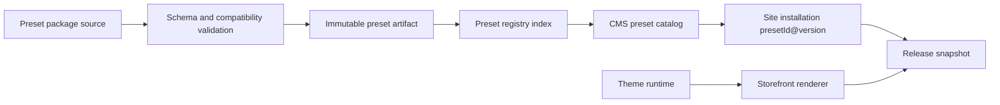

# Versioned storefront preset registry

**Status:** approved for documentation
**Date:** 2026-10-24

## Context

Storefront presets currently live in code. `backend/src/presets/catalog.ts`
contains every manifest, and the Storefront selects special themes by preset ID.
Adding a preset or changing its page structure therefore requires coordinated
changes to the backend and Storefront, followed by a full application deploy.

The platform already has the right runtime boundaries: preset import creates CMS
models and draft pages, and the publish flow produces immutable Releases. The
maintenance problem is the source and delivery of preset definitions, not the
tenant or Release model.

## Goals

- Add a content-only preset package without changing core backend code.
- Support many presets that share an approved theme runtime.
- Publish new versions without mutating previously installed sites.
- Validate a preset before users can install it.
- Let sites review and explicitly upgrade to a newer preset version.
- Keep the first implementation operable by the current engineering team.
- Leave a migration path to a centrally managed dynamic registry.

## Non-goals

- Executing JavaScript or uploading arbitrary Nuxt source through the CMS.
- Automatically upgrading existing sites.
- Silent changes to a published preset version.
- Supporting untrusted third-party marketplace authors in the first release.
- Moving existing Release snapshots into the registry.

## Architecture



The design has three independently maintained layers.

### 1. Preset package

A preset package contains declarative data and reviewed assets. It never contains
executable remote code.

```text
packages/
  aeroframe/
    1.0.0/
      preset.json
      models.json
      pages.json
      sections.json
      samples/
        entries.json
      media/
        hero.jpg
        manifest.json
      changelog.md
      checksums.json
```

`preset.json` is the entry point:

```json
{
  "schemaVersion": 1,
  "id": "aeroframe",
  "version": "1.0.0",
  "name": "AeroFrame",
  "description": "Storefront for drone and low-altitude technology brands.",
  "theme": {
    "key": "industrial-mission",
    "version": "1.0.0"
  },
  "compatibility": {
    "storefront": ">=1.0.0 <2.0.0"
  },
  "entrypoints": {
    "models": "models.json",
    "pages": "pages.json",
    "sections": "sections.json",
    "samples": "samples/entries.json",
    "media": "media/manifest.json"
  }
}
```

The package may describe:

- CMS models, fields and references
- page blueprints, paths, required sections and navigation defaults
- theme tokens and supported theme variants
- sample Entries and asset references
- upgrade notes and compatibility metadata

The package may not:

- import Vue or JavaScript modules
- reference arbitrary remote scripts
- override server routes or security policy
- mutate an installed site during catalog sync

### 2. Theme runtime

The Storefront ships versioned renderers and approved section components. A
package selects a runtime by `theme.key` and `theme.version`; it must not branch
on a hard-coded `preset.id`.

```ts
type ThemeSectionRegistry = {
    hero: SectionComponent;
    productGrid: SectionComponent;
    solutionCards: SectionComponent;
    faq: SectionComponent;
};
```

Theme token changes, page section ordering, copy and media can be delivered as
package data. New layouts or interactions require a new theme runtime version
and a Storefront deployment. This boundary keeps preset updates predictable and
prevents uploaded content from becoming executable application code.

### 3. Preset registry

The registry exposes immutable package metadata to the CMS. It stores package
identity, version, checksum, artifact location, status and compatibility.
The CMS catalog reads only packages in the `available` state.

## Delivery modes

### Phase 1: Git-backed registry

Preset packages live in a dedicated directory or repository. CI runs validation,
builds an index and stores content-addressed assets. The application bundle reads
the generated index at startup.

This mode is recommended first because every change is reviewable in Git and the
deployment remains simple. Adding a regular preset requires a new package and a
normal application deploy, but no core code changes.

### Phase 2: Dynamic registry

The same immutable artifacts are uploaded to object storage. PostgreSQL or
MongoDB stores registry metadata and publication status. The CMS syncs the index
through a protected administrative operation and invalidates its cache.

This mode allows new content-only presets and version variants to become
available without redeploying the backend or Storefront. Theme runtime changes
still require a Storefront release.

### Phase 3: Managed marketplace

Third-party authors receive a package SDK and submission workflow. Their packages
remain declarative, are validated in an isolated worker, and select only approved
theme runtimes. A human review and rollout process is required before such
packages become visible to sites.

## Installation and upgrade

An installation records an immutable preset reference:

```json
{
  "presetId": "aeroframe",
  "presetVersion": "1.0.0",
  "packageChecksum": "sha256:...",
  "themeKey": "industrial-mission",
  "themeVersion": "1.0.0"
}
```

Import behavior:

1. Resolve `presetId@version` from the registry.
2. Verify checksum and compatibility.
3. Build an import plan using actual target workspace and site IDs.
4. Create or reuse CMS models through stable keys.
5. Create draft pages and optional sample Entries.
6. Mark the installation ready only after every object is committed.

Catalog listings show the latest stable version. A new site installs the latest
stable version. An existing site stays pinned to its installed version.

Upgrading is explicit:

1. Resolve the target version and its migration path.
2. Compare field, page and navigation changes.
3. Check required content and missing media.
4. Preview the site with existing Entry data.
5. Apply model migrations in a recoverable operation.
6. Publish a new Release.
7. Keep the previous Release available for rollback.

## Versioning rules

- `schemaVersion` changes when package structure changes incompatibly.
- Package versions follow semantic versioning.
- Published versions are immutable.
- Corrections to a published version create a new patch version.
- Adding compatible pages or optional fields creates a minor version.
- Removing fields, changing page identity or changing required semantics creates
  a major version.
- Theme runtime versions are independent from package versions.
- A package cannot be installed when its requested theme runtime is unavailable.

Existing installed sites must continue to resolve their pinned package and theme
versions even after a newer version becomes the catalog default.

## Validation

Every preset must pass:

- JSON Schema validation for package, models, pages, samples and media manifest.
- Globally unique package ID and immutable version/checksum check.
- Stable model, field, page and section keys.
- Reference integrity between Entries, pointers and page bindings.
- Route uniqueness and reserved-path checks.
- Presence of every referenced section in the selected theme runtime.
- Required media checksum, MIME type and dimensions.
- Sample data validation against the declared content models.
- Storefront compatibility range check.
- Publication dry run using synthetic or migrated site data.
- Desktop and mobile preview generation for every supported page type.

Validation fails closed. A failed package cannot enter the `available` state.

## Storage and lifecycle

Registry package states:

```text
uploaded -> validated -> available -> deprecated -> retired
```

- `available`: selectable for new sites.
- `deprecated`: visible with a migration recommendation, still resolvable.
- `retired`: hidden from new installs but resolved for existing pinned sites.
- Deleting a version used by an installation or a Release is prohibited.

Artifacts are stored under content-addressed paths such as
`presets/aeroframe/1.0.0/<checksum>/`. The registry index contains stable public
metadata only. Draft packages, review notes and checksums are not exposed through
the public catalog.

## Error handling and recovery

- Catalog sync uses a complete index revision so partial publication cannot
  expose a half-updated version.
- Import uses an idempotent operation key and can resume after interruption.
- Existing installations are not rewritten by catalog synchronization.
- An upgrade failure leaves the previous installation and Release intact.
- A missing package artifact fails installation before any CMS objects are
  created.
- Registry cache failures fall back to the last complete index revision.
- Checksum mismatches block package resolution and installation.

## Migration from the current code

### Phase 1

1. Introduce the package directory, JSON schemas and loader.
2. Move Atelier, Market and AeroFrame manifests into versioned package files.
3. Replace `preset.id` component branching with a theme registry.
4. Generate the catalog index during build.
5. Preserve current model and page keys so existing installations remain valid.

### Phase 2

1. Add registry storage and artifact upload.
2. Add validated synchronization and an administrative publish action.
3. Cache the active registry revision.
4. Add version history and package deprecation controls.

### Phase 3

1. Add package submission, review and signing.
2. Add isolated validation workers.
3. Add author permissions and rollout controls.
4. Keep arbitrary code execution outside the registry.

## Acceptance criteria

- A new content-only preset using an existing theme can be added without changing
  backend controller code or Storefront page components.
- Existing installed sites remain unchanged when a newer preset version is
  published.
- Invalid schemas, unresolved references, missing sections and missing media are
  rejected before becoming available.
- Upgrade preview shows field, page, navigation and asset differences.
- Failed import or upgrade leaves the previous site configuration intact.
- The catalog and installation resolve exact immutable version and checksum.
- AEROWORKS can be created through the existing MCP workflow using the
  `aeroframe` preset and remain editable through generated CMS models.
