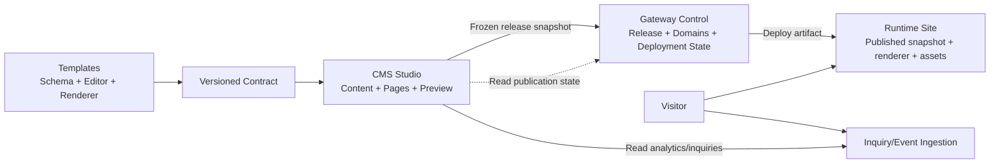

# 模板驱动内容与运行时隔离设计

日期：2026-10-31

## 目标

建立清晰的三仓职责边界：

- Templates 定义模板所需的内容模型、编辑能力、页面能力和渲染契约。
- CMS 根据模板契约提供内容维护、页面维护、预览、权限、发布请求、发布状态展示、访问与询盘看板。
- Gateway 拥有域名、发布任务、活动版本、部署实例和流量路由状态。
- 已上线网站拥有自足的运行产物，不依赖 CMS 编辑接口或 Gateway 控制接口才能提供访问。

CMS Studio 可视化页面编辑器是内容维护后台的一部分：它使用模板声明生成可编辑区块和页面属性，保存为草稿；预览和发布沿用版本化快照与 Gateway 发布流程。

## 核心原则

1. 模板定义数据需求，CMS 不为每个模板编写固定业务分支。
2. 模板、契约、CMS、Gateway、运行时均使用明确版本。
3. 草稿和已发布版本分离；发布操作生成不可变快照。
4. Gateway 是发布和部署状态的唯一权威来源。
5. 线上运行时不依赖 CMS 或 Gateway 控制面。
6. 内容数据、运行状态、统计事件和询盘状态分别拥有明确归属。
7. 兼容性由契约测试和跨仓集成测试证明，不以各仓单独测试代替。

## 目标数据流



## 状态归属

| 状态 | 权威组件 | CMS 行为 |
| --- | --- | --- |
| 草稿内容 | CMS | 编辑、校验、保存 |
| 页面布局草稿 | CMS | Studio 可视化编辑 |
| 内容 Release 快照 | CMS，提交后不可变 | 查询历史、生成发布请求 |
| 发布任务 | Gateway | 查询状态、展示失败原因 |
| 活动模板/内容版本 | Gateway | 展示当前线上版本 |
| 域名和证书 | Gateway | 展示配置状态 |
| 运行实例和路由 | Gateway/运行时 | 展示健康状态 |
| 访问事件 | 独立事件服务 | 查询看板 |
| 询盘记录和处理状态 | 询盘服务 | 查询、分配、处理 |

## 契约模型

模板发布必须提供以下版本化文件：

- `template.json`：身份、版本、兼容的 CMS/release schema、内容模型、页面蓝图、主题和资源。
- `editor.json`：字段分组、编辑控件、页面区块、属性面板、默认值、条件显示、权限需求。
- `renderer-contract.json`：快照入口、支持的视图、路径、区块和预览消息协议。
- `migrations/`：从兼容旧版本到当前版本的数据迁移。
- `contract-tests/`：用标准 CMS fixture 验证编辑、预览、发布和渲染。

模板不直接修改 CMS 业务代码。CMS 通过契约生成或选择：

- 内容模型和字段表单。
- 页面蓝图和页面创建向导。
- 区块列表和区块属性面板。
- 页面路径和导航约束。
- 发布前校验规则。
- 预览和发布快照投影。

模板升级分为：

- 展示兼容：只修改样式或渲染实现。
- 数据兼容：字段和页面身份保持稳定，可直接采用。
- 需要迁移：需要执行版本迁移后才能采用。
- 不兼容：需要新建站点或人工迁移。

## CMS Studio

Studio 负责：

- 内容模型驱动的字段维护。
- 页面、区块、SEO、导航和站点设置的草稿维护。
- 模板提供的真实预览。
- 保存草稿、查看差异和提交发布请求。
- 展示 Gateway 发布状态。
- 访问数据、询盘数据和操作审计看板。

Studio 第一阶段采用三栏页面编辑器：

- 顶部：页面标题、草稿状态、保存、预览、发布。
- 左栏：页面列表、区块列表、导航树。
- 中栏：真实模板草稿预览。
- 右栏：区块属性、页面属性、SEO、绑定内容、显示状态。

页面区块继续兼容现有 `sectionConfigs`，同时增加可选 `layoutDocument`：

```ts
interface LayoutDocument {
  version: 1;
  mode: 'template' | 'structured';
  root: LayoutNode[];
}
interface LayoutNode {
  id: string;
  kind: 'section' | 'container' | 'component';
  type: string;
  enabled: boolean;
  props: Record<string, unknown>;
  children: LayoutNode[];
  layout?: {
    display?: 'flow' | 'grid' | 'flex';
    columns?: number;
    gap?: string;
    align?: 'start' | 'center' | 'end' | 'stretch';
    responsive?: Record<string, Record<string, unknown>>;
  };
}
```

第一阶段固定使用 `mode: 'template'`，根节点是扁平区块。节点 ID 用于选中、拖拽、预览消息、差异和后续撤销；数组索引不能作为永久身份。

Studio 保存页面时：

1. 加载并验证 `expectedUpdatedAt`。
2. 规范化 `layoutDocument`。
3. 投影为兼容的 `sectionConfigs`。
4. 校验允许区块、必需区块、重复区块、媒体引用、路径和导航。
5. 原子保存完整页面草稿。
6. 返回规范化后的完整页面状态。

新增页面必须由一个服务端操作同时创建内容条目、页面草稿和绑定关系，不能由客户端拆成多个无事务请求。

## 发布流程

1. CMS 根据模板契约和编辑数据构建 ReleaseSnapshot。
2. CMS 解析媒体引用，生成发布资源清单。
3. CMS 对快照做 canonical JSON、checksum 和契约校验。
4. CMS 以 request key 向 Gateway 提交不可变 Release。
5. Gateway 验证模板记录、快照身份、资源和版本。
6. Gateway 创建候选运行实例或静态部署。
7. Gateway 完成健康检查、路由切换和活动版本写入。
8. Gateway 返回活动版本和发布状态。
9. CMS 将 Gateway 状态投影到 Studio，但不自行推断发布成功。

内容发布和模板运行环境升级可以分成两类：

- 快速内容发布：运行时读取新的不可变快照或切换静态产物。
- 模板运行时升级：构建新的运行产物，完成完整健康检查后切换。

两者都使用相同的版本和回滚协议，但不要求每次内容更新都重新构建模板镜像。

## 线上运行时隔离

发布产物必须包含：

- 模板渲染器版本。
- 内容快照。
- 图片和其他发布资源。
- 路由和重定向。
- SEO、主题、导航和运营配置。
- 运行健康检查。

运行实例不能依赖：

- CMS 草稿接口。
- CMS 登录或编辑凭据。
- Gateway 控制 API 的实时查询。
- CMS 私有媒体 URL。
- 短期预览 token。

Gateway 控制服务、发布 worker、流量入口和运行实例分离部署。控制服务停止时，已有路由继续服务；worker 停止时，已有实例继续服务；CMS 停止时，网站继续服务。

询盘接收和访问事件采集使用独立入口。网站页面不因 CMS 看板、Gateway 控制 API 或统计服务暂时不可用而无法访问。

## 迁移原则

当前三仓已有发布逻辑、模板 registry、CMS Studio、Gateway publication state 和本地路由实现。迁移采用兼容过渡：

1. 先定义契约并修复当前 CMS 输出与模板严格解析器的字段漂移。
2. 再把模板模型和编辑元数据移入模板契约。
3. 再把 Studio 改为契约驱动，并加入可视化页面编辑器。
4. 再将发布资源从 CMS 媒体接口迁移到运行时可独立读取的资源存储。
5. 最后拆分 Gateway 控制面、流量入口和运行实例。

现有站点在迁移过程中继续使用兼容投影；每一步均需要跨仓回归和可回滚开关。
