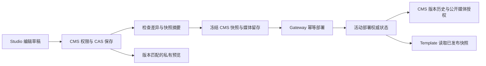

# CMS Studio P0 实施与验收记录

> 历史阶段记录。下文“未提交”“Docker 不可用”和测试计数描述当时状态；最终提交与 Docker 复验结果见 [发布候选收口](2026-10-28-release-candidate.md)。

日期：2026-10-28。范围：已配置单站点的展示/询盘工作流。当前为本地源码实现与隔离环境验收；未推送、合并、发布镜像/注册表或部署生产。

## 本轮交付

| 层级 | 实际变化 | 操作入口/边界 |
| --- | --- | --- |
| CMS Studio | 真实商品/内容、页面、图片选择、站点名称/配色、发布中心 | `/d/studio`；通过 SDK 与受保护 API 保存，保留原完整编辑器 |
| CMS 业务接口 | 已安装模型映射、权限、字段保留、Entry CAS、幂等页面创建 | `/api/v4/studio`；已有富文本和其他语言不被简化表单覆盖 |
| CMS 发布 | 检查快照摘要、结构化错误定位、不可变快照、操作者、历史/审计、回滚 | Gateway 发布与本地发布分别记录当前版本；历史快照回滚不会夹带最新草稿 |
| Gateway | 权威活动部署查询 | 新增服务鉴权 `publication-state`；校验快照原始校验和、大小及归属 |
| Templates | 新增不可变 AeroFrame 1.0.3 | 显式页面类型、配色、区块顺序、同渲染器私有预览；1.0.0–1.0.2 未改动 |
| 预览桥接 | 精确 origin/source/模板版本握手 | 1.0.3 必须配置匹配服务；旧公开版本显示不支持提示，内置1.0.0标为内容检查 |

发布请求即使丢失响应，服务端定时恢复也只重放原冻结请求。`operation.ready` 必须经活动部署确认，才成为本地已发布投影；失败候选不会授权匿名访问图片。回滚将历史快照及当时模板身份提交为新的部署操作。

## 备份与改动位置

三仓均在 `codex/cms-studio-p0` 分支，未提交。基线分别为 CMS `b62bb88`、Gateway `5797798`、Templates `a8c3768`。

完整源文件备份在 `/Users/445101599qq.com/Projects/cms-backups/20261028-092626`，包含三份 tar.gz 与 SHA-256 manifest；本轮已重新计算，三个摘要均一致。备份排除了依赖、构建物及 `.env*`/`.npmrc` 等配置文件。恢复源码前需自行保留当前后续修改；本备份不代替数据库或凭证备份。

本轮保留已有 `/ui/prototype`、用户已改的 `product-preview.tsx` 与内置 `storefront/app/pages/preview.vue`，未覆盖。旧原型仍位于5175，前一版原型位于5176。真实 Studio 验收环境是8086。

## 本地运行与浏览器验收

临时 MongoDB：`mongodb://127.0.0.1:27028/`。仅监听 loopback，测试使用随机独立数据库。测试运行时没有加载生产 `.env`。

真实 Studio 验收页：`http://127.0.0.1:8086/d/studio`。该进程使用真实受保护控制器、仓储和 MongoDB，Gateway 关闭；验收账号、JWT 密钥和数据库与生产隔离。原型页面与此入口是不同实现。

浏览器已验证：

1. 正常登录，切换“Studio 本地验收”工作空间并选择 FORM Studio。
2. 商品列表进入编辑，修改描述，保存成功后重新打开，读取到保存后的实际内容。
3. 新增 Shipping policy 页面与正文，保存后页面列表出现 `/shipping-policy`，内容绑定完成。
4. 发布中心执行预检，返回7个具体路径及导航变化；未点击正式生产发布。

本地服务器与临时数据仅用于验收，关闭进程后不保证继续可用。正式项目启动仍应使用项目部署流程。

## 验证证据

| 检查 | 结果 |
| --- | --- |
| CMS 全部36个测试文件（含临时 Mongo/HTTP 集成） | 138通过，0失败，0跳过 |
| Studio 权限、字段保留、并发、幂等与真实 Mongo/HTTP | 已包含在后端全量测试；独立运行12通过 |
| Gateway 媒体匿名 HTTP 与本地发布集成 | 2通过；覆盖候选私有、活动/历史图片公开、失败保持私有 |
| Backend `npm run build:noEmit` | 通过 |
| UI `node --test test/*.test.mjs` | 29通过，1项部署 CSP 条件测试跳过 |
| UI 类型检查和生产构建 | 通过；保留已有 Sass/Tailwind/包体积提示 |
| Gateway control 测试及 Next 生产构建 | 68通过，27项 PostgreSQL 条件测试跳过 |
| Templates 注册/清单/版本单测 | 29通过 |
| AeroFrame1.0.3 单测 | 15通过 |
| AeroFrame1.0.3 Nuxt生产构建及真实 Node 运行时测试 | 通过，运行时集成1通过 |
| 全部四版模板清单校验 | 通过；旧版目录 diff为空 |
| 三仓 diff空白检查 | 通过 |

后端全量命令使用 Node22 的 `--test-force-exit`，因为原有 MCP 测试导入的全局定时器在断言结束后仍保持进程；本轮新增集成测试单独执行可正常结束。域名集成需提供非生产测试用 `STOREFRONT_GATEWAY_SECRET` 和 `STOREFRONT_DOMAIN_SECRET`；首次漏配导致404，补齐后133项通过；媒体修复后最终138项全部通过。

完整日志保存在 `.superpowers/sdd/2026-10-28-cms-studio-p0/`。独立总审查发现的媒体部分留存失败问题已修复并复核：每次请求使用独有临时 token 获取全部媒体锁，已知缺失/删除冲突时仅清理本次 token；全部锁定后再逐条原子转换为正式 Release pin，避免误清并发成功请求或历史有效 pin。新增5项真实 Mongo 回归，与相关生命周期/HTTP共48项通过；最终全量138项通过，类型检查与三仓 diff 检查通过。

未知数据库写入/清理结果、进程崩溃或随后 Release 插入失败仍保守留存，等待相同冻结请求恢复或运维对账；本轮不会追溯删除旧代码已产生的锁。独立复核未确认新的并发缺陷。

## 上线前仍需完成

- Gateway 的27项数据库集成测试需要可用 PostgreSQL；本地 Docker daemon 不可用，模板 Docker 镜像 smoke 未通过环境检查，不能把 Node 运行时测试视为镜像验证。
- 单独发布、签名验证并登记不可变1.0.3镜像；站点显式采用该版本。源码实现不会自动升级已有1.0.1/1.0.2网站。
- 配置 CMS `VITE_TEMPLATE_PREVIEW_ORIGIN`、renderer `NUXT_PUBLIC_PREVIEW_ADMIN_ORIGIN`，按精确 origin 配置 CSP，再验收浏览器草稿到匹配 renderer 的完整闭环。见 `docs/operations/template-preview.md`。
- 将三个项目按依赖顺序部署到验收环境，完成真实 Gateway worker 切流、域名、HTTPS、CDN/图片和回滚联调。本轮没有操作生产。
- 失败快照及未知网络结果的媒体留存遵循保守策略；自动回收/保留期限属于后续运维策略，不擅自删除历史资源。

P1/P2 保持后续规划：多站点自助开通、按站点 Gateway 配置、租户计费、完整询盘线索管理、电商订单支付、可观测性与高可用。此次P0不包含这些能力。
