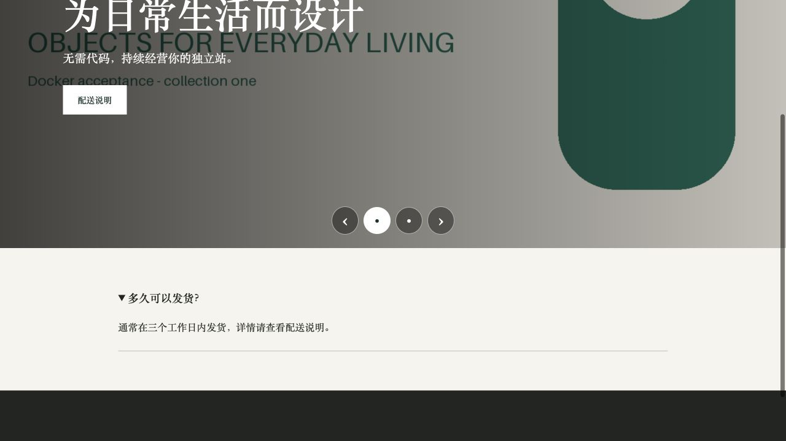
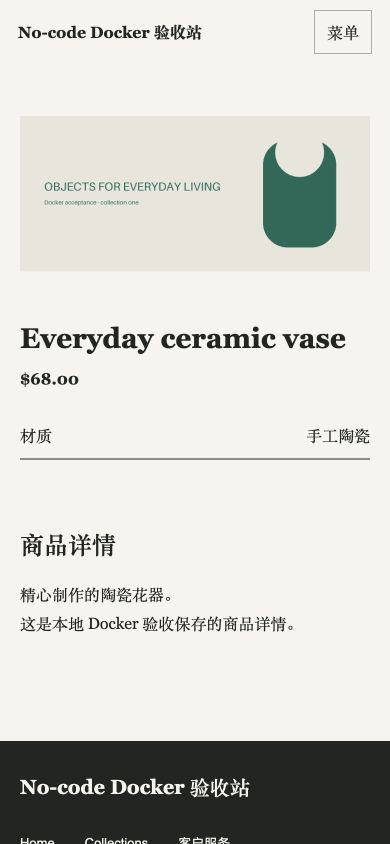

# 2026-10-30 非技术建站流程：本地 Docker 部署与端到端验收

## 结论

当前工作树已部署到本地 Docker。创建网站、维护内容与导航、桌面和手机预览、发布、回滚、再次发布的核心流程通过真实浏览器验收。验收发现的编辑器、图片解析、导航和响应式问题已修复，并重建镜像复验。

自动化测试合计 **277 项通过，0 失败，0 跳过**；另有 **11 项 HTTP/API 检查**通过。浏览器检查清单单独记录，不计入自动化测试数量。此结论针对本轮内置 Atelier 建站和发布流程，不等同于所有生产基础设施已经验收。

## 部署与数据边界

| 用途 | 入口 | 最终状态 |
| --- | --- | --- |
| 原本地 CMS | http://localhost:8080/d/studio | 200，当前源码，保留业务数据 |
| 原本地独立站 | http://localhost:3000/ | 200 |
| 隔离验收 CMS | http://127.0.0.1:18080/d/studio | 200，生产构建镜像 |
| 本轮验收独立站 | http://127.0.0.1:13002/ | 200，生产构建镜像 |
| 验收商品详情 | http://127.0.0.1:13002/products/featured-product | 200 |
| Gateway control readiness | http://127.0.0.1:18183/api/v1/health/ready | 200 |

- 分支：`codex/nocode-independent-sites`。基础 HEAD：`25f7021003e8521e9fcb19566634a581dfb1b5f3`。部署包含当前未提交修改，未提交、未推送。
- 原开发 Compose 的 backend、UI、storefront 已重建运行，源码挂载与工作树一致。原数据目录和 Docker 数据卷保留，未向原业务网站发布验收内容。
- 生产模式验收使用 `ops/e2e/compose.yml`，独立 Mongo/PostgreSQL 和验收数据。新建工作区为 `No-code 验收 2026-10-30`，网站为 `No-code Docker 验收站`，内置模板为 Atelier 1.0.0。
- 本轮站点 ID：`32eb4c64-6d3d-44ce-92e3-28697c210005`。最终发布版本：`dbd44c06-ee66-4944-b1a0-e5e11e4dad56`。
- 镜像保留原验收标签 `local/cms-e2e:20261028` 与 `local/cms-storefront-e2e:20261028`，实际已于本轮重新构建。镜像 ID、容器状态和请求结果见 [final-runtime.json](evidence/2026-10-30-nocode-docker-e2e/final-runtime.json)。
- 构建使用排除凭据、数据库、上传、依赖与构建产物的净化上下文。1288 个构建输入文件的哈希与工作树及构建上下文匹配；生产 CMS 的 302 个后端源文件、开发容器的 302 个后端源文件、261 个 UI 源文件、22 个 storefront 应用文件均核对一致。生产 storefront 通过镜像 ID、公开 CSS 和真实页面复验确认。

## 真实浏览器验收

所有操作均通过应用真实界面完成，配合只读 DOM 测量和 HTTP/API 核对。

| 场景 | 结果 |
| --- | --- |
| 创建工作区、选择 Atelier、创建网站、导入示例内容、进入整站预览 | 通过 |
| 编辑首页并保存草稿，公开页面保持旧版本 | 通过 |
| 新建 `/delivery` 配送说明页面并维护正文 | 通过 |
| 配置两张轮播图片、标题、副标题和站内 CTA，保存刷新后持久化 | 通过 |
| 配置 FAQ、商品图库、规格和详情正文 | 通过 |
| 通过 UI 上传 `acceptance.png` 并选择为网站图标 | 通过 |
| 创建“客户服务”分组，把已有配送说明移入分组并保存 | 通过 |
| 保存搜索描述、分享图和图标，发布资源返回 200 | 通过 |
| 发布、恢复首个版本、重新发布最终草稿 | 通过 |
| 桌面下拉点击、Enter 展开；轮播上一张/下一张/圆点；FAQ 展开 | 通过 |
| 轮播左右方向键切换 | 通过 |
| 390px 已发布网站：菜单、分组、配送说明跳转和菜单收起 | 通过 |
| 390px 已发布网站：轮播切换、FAQ、商品图片加载、规格和正文 | 通过 |
| 390px 草稿预览：站内跳转后菜单自动收起 | 通过 |

桌面首页实际 `innerWidth = scrollWidth = 1280`；手机首页、配送说明及商品详情实际宽度均为 390px，无横向溢出。手机公开页面使用真实 390px 浏览器视口，另验收了后台的 390px 预览 iframe。验收后调用视口重置。

首次版本为 `79e00c9e`，第二次发布为 `4221a387`。通过 UI 恢复首次版本后，原首页恢复、配送说明返回 404，回滚审计存在；再次发布后保留最终版本 `dbd44c06`。过期 `expectedReleaseId` 与预检后草稿变化均被拒绝，活动版本与公开 HTML 未改变。

浏览器详细清单见 [browser-acceptance.json](evidence/2026-10-30-nocode-docker-e2e/browser-acceptance.json)；发布、回滚和冲突核对见同目录 JSON 证据。

## 本轮发现并修复的问题

1. 区块编辑器缺少内容字段；补齐轮播、FAQ、信息卡片、商品图库、规格和正文。修复 Vue Proxy 克隆错误、空图片首行无法选择和空 CTA 对象，保留必需区块并校验必填内容。
2. 设置提交混入不受 schema 支持的 theme 字段；改为明确构建请求。分享图和图标改为素材选择，区块及 SEO 选择器只展示绑定当前网站的图片，继续保留后端严格网站隔离。
3. 轮播、商品图库、分享图和图标未统一解析媒体 URL；后端生成正确的 CMS 资源地址，并正确处理草稿预览能力令牌和公开发布。
4. 安装模板的商品详情忽略区块配置；接入配置后的图库、规格、正文和 FAQ 渲染。
5. 已有导航页不能移入分组；增加所属分组选择，保留唯一链接并防止循环。桌面下拉改为可点击、可键盘操作的原生展开控件。
6. “打开独立站”错误使用所有网站共享的默认入口；改为解析所选网站的主域名及默认站点入口。
7. 轮播 CTA 缺少安全协议限制；后端只接受有效站内路径或 HTTP/HTTPS 地址。
8. 轮播缺少 CSS，1440px 原始图片撑宽 1280px 页面；补齐轮播、FAQ、信息卡片和移动端样式，限制图片尺寸并提供可触达的控制按钮。
9. 草稿预览拦截链接冒泡，导致跳转后手机菜单仍展开；保留默认跳转拦截，同时允许菜单回调执行。真实预览复测菜单已收起。
10. 原 8080 代理缓存重建前的 UI 地址，导致页面 502；确认 UI 容器本身 200 后，校验并重新加载 nginx，8080 页面及健康检查恢复 200。未修改业务数据。

独立代码审查发现的素材选择器站点绑定问题已修复，并通过失败/成功回归及部署后的实际选项检查。编辑器、导航和发布地址修复有针对性回归测试；响应式与预览菜单修复由原缺陷复现及真实浏览器复验覆盖。

## 自动化与构建结果

| 验证 | 结果 | 证据 |
| --- | --- | --- |
| 后端单元及真实 Mongo/HTTP 集成 | 184 通过，0 失败，0 跳过 | `backend-suite-verified.log` |
| UI 契约与行为测试 | 80 通过，0 失败，0 跳过 | `ui-suite-verified.log` |
| Storefront 测试 | 13 通过，0 失败，0 跳过 | `storefront-suite-verified.log` |
| 后端 TypeScript | 通过 | `backend-typecheck.log` |
| UI 类型检查及 Vite 构建 | 通过 | `ui-build-verified.log` |
| Storefront TypeScript | 通过 | `storefront-typecheck.log` |
| CMS 与 Storefront 生产镜像构建 | 通过，已重建部署 | `build-cms-final.log`、`build-storefront-final.log` |
| 发布 HTML、媒体、SEO、sitemap、错误 Host/路径、过期发布保护 | 11 项通过 | `published-verification.json` |
| 预检后草稿变化冲突保护 | 通过，已恢复测试草稿 | `preflight-conflict.json` |
| 源码与镜像核对、健康检查、公开入口 | 通过 | `final-runtime.json` |
| `git diff --check` | 通过 | 最终工作树检查 |

所有上表证据均位于 [本轮 evidence 目录](evidence/2026-10-30-nocode-docker-e2e/)。构建保留现有大 chunk 等警告，没有构建错误。

## 验收范围与未验证项

- `nocode.localhost` 是隔离数据库中的路由 fixture；其 verified/ready 状态及 UI 的 HTTPS 标记用于本地测试，不代表真实 DNS 所有权、证书签发或公网 HTTPS 成功。实际验收入口为 13002 的本地 HTTP。
- 本轮新建站点采用内置 Atelier 发布，没有 Gateway 绑定。Gateway control readiness 已检查，后端相关集成测试通过；本轮未重新执行跨仓公开模板的容器切流故障验收，历史结果不计入本轮通过数量。
- 邮件投递未配置，联系表单保持禁用；支付未接入。备份及恢复在运营状态中保持 unknown，本轮未执行恢复演练。上述能力未被标为通过。
- 桌面及 390px 响应式已验收，没有声称覆盖所有浏览器、设备、生产负载或多机部署。
- 运行凭据、原始会话及含内部密钥的入口配置仅保留在忽略目录，未复制到交付证据。

## 截图





手机首页、展开菜单、修复后的草稿预览菜单、后台轮播编辑和最终发布中心截图同时保留在 evidence 目录。

## 复验入口

```sh
node ops/e2e/test.mjs backend
node ops/e2e/test.mjs ui
npm --prefix storefront test
npm --prefix backend run build:noEmit
npm --prefix ui run build
npm --prefix storefront run typecheck
git diff --check
```

本轮专用的 `verify-published.mjs` 与 `verify-runtime.mjs` 保存在忽略的 `.superpowers/sdd/nocode-docker-e2e-20261030/`，前者执行隔离站点的发布与资源断言，后者核对构建清单、运行源码、镜像和入口。容器保持运行，原数据卷与验收证据均保留。
