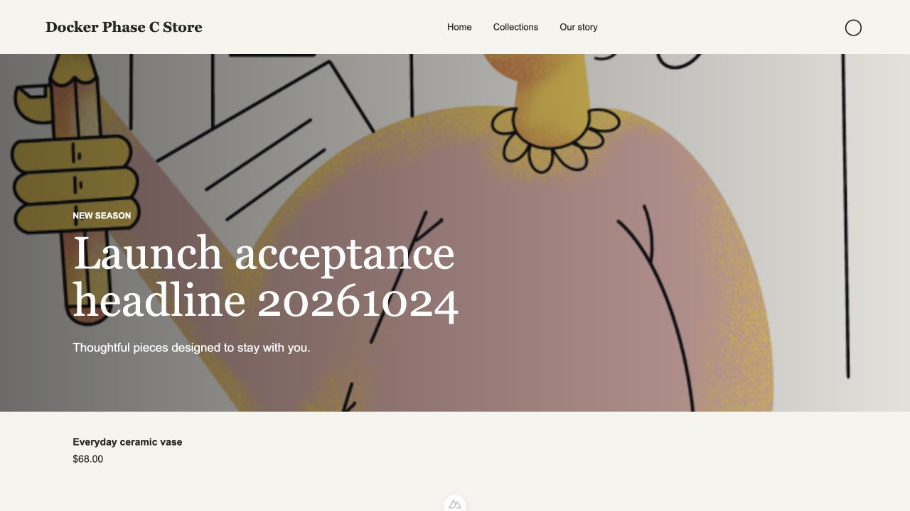

# 本地 Docker 建站上线验收

> 后续更新：本报告记录的三个页面问题已修复并完成本地 Docker 定向复测，见 [修复复测报告](storefront-local-launch-fixes-2026-10-24.md)。以下保留首次验收时的失败结论和原始证据。

验收日期：2026-10-24（Asia/Shanghai）。用户明确本次仅验收本地 Docker，不包含真实域名、DNS、证书或生产部署。

## 结论

**验收已执行，整体不通过。** 已有内容站点的编辑、发布、公开访问、改址、下线、回滚、媒体发布与重启持久化均通过；从空站点首次创建内容以及管理端预览存在可复现阻断，不能据此标记完整建站闭环完成。

## 代码与运行环境

- 主工作目录：`/Users/445101599qq.com/Projects/cms`，分支 `codex/storefront-domains-workspaces`，业务代码基线 `a89e31d`。
- 本次修改只涉及集成测试夹具、验收记录及证据，没有修复以下产品缺陷；未提交、推送或再次合并。
- 测试既有的 Compose 部署：`db`、`backend`、`ui`、`storefront`、`proxy`。开发容器通过 bind mount 使用主工作目录源代码。
- 管理端：`http://localhost:8080`；公开站点：`http://localhost:3000`。
- 发布原先被禁用的原因：开发 Compose 后端只加载 `backend/.env`，根目录 `.env` 中的 `STOREFRONT_ENABLED=true` 不会自动传给后端。本次在被 Git 忽略的 `backend/.env` 中加入 `STOREFRONT_ENABLED=true` 和 `STOREFRONT_HOST=localhost:3000`，并重建后端容器配置（未重新构建镜像）。
- Mongo/HTTP 测试使用 `127.0.0.1:27028` 上已有独立测试 Mongo，各测试使用随机数据库并自行清理；不使用现有管理端数据库执行破坏性断言。
- 浏览器和部署生命周期测试在本地现有部署新增专用验收账号、两个测试站点、页面草稿、Release 和一张项目自带 PNG，保留用于复验，没有覆盖已有站点内容。

## 自动化结果

| 检查 | 本次结果 |
| --- | --- |
| 后端建站、域名、工作区与 Entry 测试 | 73/73 通过，0 跳过；包含此前跳过的 9 项真实 Mongo/HTTP 测试 |
| Nuxt SSR 集成 | 随后端集成执行：真实 HTTP 渲染、域名受信任请求、canonical、别名 301、sitemap、切主域名及挑战签名通过；域名就绪状态使用受控适配器 |
| Storefront 测试 | 12/12 通过 |
| UI 现有测试 | 6/6 通过 |
| Docker HTTP 发布生命周期 | 1/1 通过 |
| 后端 TypeScript | `npm run build:noEmit` 通过 |
| 差异格式 | `git diff --check` 通过 |

证据：[后端 TAP](evidence/2026-10-24-launch/backend-tests.tap)、[Storefront/UI/部署 TAP](evidence/2026-10-24-launch/other-tests.tap)。这些测试通过不代表下述浏览器缺陷已修复。

首次启用集成测试时，夹具未初始化最新依赖仓储、未持久化 JWT 对应身份、未提供内容权限，且部分断言/竞态钩子使用了错误的工作区缓存上下文。本次补齐真实身份与依赖、明确管理员安装和成员内容授权、修正作用域与竞态钩子；保留跨站点拒绝、越权拒绝、发布隔离和并发 CAS 等原有断言。旧商品接口的“安装后拒绝访问”测试现在携带有效认证，避免把认证 403 误当作业务路由 404。

复跑后端集成（从 `backend/` 执行；13001 端口需空闲，Storefront 已有 `.output` 构建产物）：

```sh
STOREFRONT_ENABLED=true STOREFRONT_HOST=127.0.0.1:13001 \
STOREFRONT_GATEWAY_SECRET=local-acceptance-gateway \
STOREFRONT_DOMAIN_SECRET=local-acceptance-domain \
STOREFRONT_TEST_MONGO=mongodb://127.0.0.1:27028 STOREFRONT_TEST_SSR=true \
node -r ts-node/register -r tsconfig-paths/register --test \
src/presets/*.test.ts src/site-domains/*.test.ts src/storefront/*.test.ts \
src/workspaces/*.test.ts src/entry/create.test.ts
```

部署生命周期脚本 `backend/test/storefront-deployment.test.mjs` 要求目标默认站点尚未安装、发布历史为空，不能直接对本次已留存的站点重跑。重新执行必须使用新的隔离部署和测试账号。

## 浏览器与公开访问结果

| 流程 | 结果与证据 |
| --- | --- |
| 登录与选择站点 | 专用本地账号登录、切换并管理站点通过 |
| 创建空站点、导入 Atelier | 页面创建 `Launch Browser Site 20261024` 并生成 5 个模型、4 个页面草稿；示例内容选项禁用，首次内容创建失败，见缺陷 |
| 已有首页内容编辑 | 将 Headline 保存为 `Launch acceptance headline 20261024`，提示更新成功；发布前公开首页仍为旧内容 |
| 新增页面 | 通过页面新增 `/launch-acceptance`，绑定 `Our story`，保存标题、SEO 描述、导航与正文区块 |
| 页面发布 | 校验列出新增 `/launch-acceptance`、修改 `/` 和导航更新；点击发布后首页与导航实际更新 |
| SEO | 新页面 `<title>` 为 `Launch Acceptance SEO`；description 与表单一致；canonical 指向 `http://localhost:3000/launch-acceptance` |
| 改址 | 页面修改为 `/launch-shipping` 并发布；旧路径 HTTP 301，Location 为 `/launch-shipping`，浏览器自动跳转；sitemap 更新 |
| 下线 | 取消加入下次发布后发布；公开 `/launch-shipping` 返回 404 |
| 回滚 | 点击历史 `39c2a893` 恢复成功；首页恢复原始标题，新增测试页面消失且 sitemap 排除测试路径；草稿仍保留 |
| 图片上传与发布 | 页面上传仓库内 `ui/public/assets/empty-state-illustrations/media.png`，选入 Hero image 并保存、发布；公开 CSS 引用稳定图片 URL，无管理 token；未认证 GET 图片返回 200，截图确认显示 |
| 公开内容页面 | 部署脚本验证首页、商品页、加页、改址、下线、SEO、sitemap、回滚、无认证与错误 Host 拒绝；测试站点初始内容由脚本导入，不能替代空站点纯页面操作验收 |
| 重启持久化 | 执行 `docker compose restart` 重启全部 5 个服务；发布版本 `8566ac12-b013-4a91-8f0c-d73bf8d3f20d`、首页新标题和图片 200 保留，公开 JSON 仍为 `Cache-Control: no-store` |

默认公开测试站点：`Docker Phase C Store`，ID `6adc3f29f6c7109dbeab71d4`。纯页面创建的空站点：`Launch Browser Site 20261024`，ID `a7ab6a9e-08eb-453a-a642-d5860c74c3f7`。未给后者伪造可用域名或发布内容。

## 需修复的页面问题

### P1：首次创建 Entry 的编辑器初始化失败

复现：选择 `Launch Browser Site 20261024` → 建站清单 → 首页的“打开编辑器” → `/d/template/6adc42101f8fb2c3dbd79ac0/entry/create`。

页面出现字段标签但标题、Headline、Introduction 与正文的编辑器未生成；DOM 中 `[contenteditable="true"]` 数量为 0。控制台报 `TypeError: Cannot read properties of null (reading 'awareness')`，刷新、新标签页和容器重启后仍可复现。空站点发布校验正确拒绝：`Exactly one home Entry is required for language en`，因创建入口失败而无法继续补齐必需内容。

原因定位：`ui/src/components/entry/content/main.tsx` 仅在 `props.entrySync` 存在时创建 `yProvider`，却无条件把可能为 null 的 provider 传给 `CollaborationCursor.configure`；创建态没有同步对象，游标插件初始化访问空 provider 的 awareness。已有 Entry 的编辑保存已通过，不能代替此路径。

证据：[控制台](evidence/2026-10-24-launch/new-entry-console.json)、[DOM](evidence/2026-10-24-launch/new-entry-dom.txt)、[截图](evidence/2026-10-24-launch/new-entry-editor.jpg)。

### P1：主题及草稿 iframe 预览被 CSP 阻断

复现：独立站模版页主题预览，或已有首页 Entry 的“预览页面”。iframe 显示“该内容被屏蔽了”，而直接访问公开 Storefront 成功。

原因定位：`proxy/nginx.conf` 响应头为 `default-src 'self' 'unsafe-inline' blob: data:; frame-ancestors 'self' http://localhost:8080;`，没有允许 `http://localhost:3000` 的 `frame-src`。8080 与 3000 不同源，默认策略阻止 iframe；`frame-ancestors` 不会授予父页面加载子框架的权限。主题封面外部图片也显示加载失败，本次未单独验收其远端可用性。

证据：[预览 DOM](evidence/2026-10-24-launch/preview-blocked-dom.txt)、[截图](evidence/2026-10-24-launch/preview-blocked.jpg)。本次没有禁用 CSP 或绕过浏览器策略来伪造通过结果。

### P2：空站点无法选择导入示例条目

复现：工作区页创建站点 → 进入模版安装 → “导入示例文本条目”未选中且禁用。导入后模型和页面生成，但内容条目为空。

原因定位：`ui/src/views/dashboard/presets.tsx` 使用 `disabled={!!site.value}` 控制该选项；D3 流程要求先创建 Site，所以首次安装时 site 已存在。此选项需要按安装状态判断，而不是仅判断 Site 是否存在。API 导入示例条目已在生命周期与集成测试通过；该缺陷针对页面入口。

## 后续复验

修复以上问题后，应从一个全新 Site 通过页面创建必需内容、验证主题与未保存草稿预览，再走发布与回滚。此次“已有内容的发布闭环通过”不能替代“空站点完整建站闭环通过”。真实域名与 HTTPS 不在本次用户确认的范围内。

公开页面证据：


