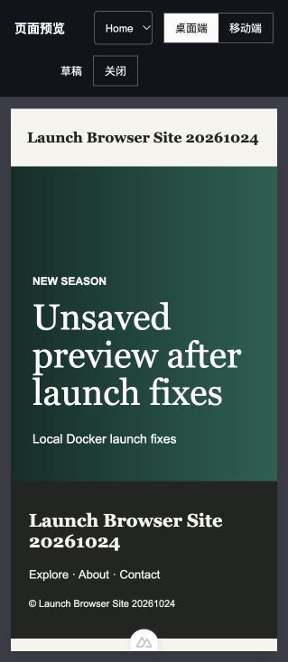

# 本地 Docker 建站验收问题修复复测

日期：2026-10-24（Asia/Shanghai）。范围为用户要求修复的三个问题，沿用本地 Docker 环境。

## 结果

**三个问题均已修复，并通过原失败路径的浏览器复测。** 原始失败记录保留在 [首次验收报告](storefront-local-launch-2026-10-24.md)。本报告记录修复后的结果，不将前次测试计数当作本次重新执行的结果。

| 原问题 | 修复 | 本次复测 |
| --- | --- | --- |
| P1：首次创建 Entry 时 provider 为 null，编辑器崩溃 | 仅在同步 provider 存在时注册 Collaboration 与 CollaborationCursor；创建态直接载入传入正文；卸载时释放 Y.Doc | 原失败站点的首页创建页从 0 个恢复为 4 个可编辑区域；填入标题、Headline、Introduction、正文后创建成功；刷新后内容完整；更新后再次刷新仍保留 |
| P1：主题与草稿 iframe 被 CSP 拦截 | 开发代理增加 `frame-src 'self' http://localhost:3000`，保留现有其他策略 | 主题预览显示实际首页；Entry 预览显示未保存的 Headline；代理回归测试由失败变为通过 |
| P2：空站点的示例导入选项禁用 | 空站点允许选择；提交中与已开始安装时锁定；重试时显示安装记录内的 includeDemo | 通过页面创建全新站点，勾选示例并安装；生成 5 个模型，品牌、商品、集合、首页、内容页各 1 条示例 |

## 本次执行的检查

- `STOREFRONT_E2E_CMS=http://localhost:8080 node --test ui/test/*.test.mjs`：7/7 通过、0 跳过。
- `npm run type-check`（`ui/`）：退出码 0。
- `npm run build-only`（`ui/`）：退出码 0；存在仓库原有 Sass、Browserslist、Tailwind 与大 bundle 提示。
- `npm test`（`storefront/`）：12/12 通过。
- `docker compose up -d --build --no-deps proxy`：重新构建并启动代理成功；UI 源码通过现有 bind mount 热更新。
- `docker compose exec -T proxy nginx -t`：配置校验通过。
- `http://localhost:3000/`：HTTP 200；5 个 Compose 服务均运行。
- `git diff --check`：通过。

新增 `ui/test/local-preview-policy.test.mjs` 实际读取管理端 HTTP 响应策略，验证本地预览来源允许、同源允许、任意远端来源未开放，并保留 frame-ancestors。设置 `STOREFRONT_E2E_CMS` 后执行；未提供环境变量时跳过该 Docker 专用测试。修复前此测试失败于 `preview origin must be allowed`。

## 浏览器证据与复验路径

### 无示例内容的首次创建

选择 `Launch Browser Site 20261024`（`a7ab6a9e-08eb-453a-a642-d5860c74c3f7`）。该站点在前次验收中已导入模型但没有内容。

1. 从建站清单打开首页创建入口 `/d/template/6adc42101f8fb2c3dbd79ac0/entry/create`。
2. 填入 `Launch First Home 20261024`、Headline、Introduction 与正文 `First entry body saved through the browser.`。
3. 创建后跳转到 Entry `6adc495fc8134a52359db411`，出现“条目创建成功”；刷新后字段与正文保留。
4. 将 Headline 改为 `Unsaved preview after launch fixes`，不保存即打开预览；iframe 中标题与未保存值一致。
5. 关闭预览、更新并刷新，确认更新值和原正文均保留。该文本中的 Unsaved 描述步骤 4 的状态，步骤 5 后已保存。

[保存后截图](evidence/2026-10-24-launch-fixes/first-entry-saved.jpg)、[未保存预览截图](evidence/2026-10-24-launch-fixes/draft-preview.jpg)。

### 选择示例导入

从工作区页面新建 `Launch Fix Demo 20261024`（`eebd9de0-48df-4bb4-b49d-f289ef04ac6e`）。修复前，该空站点复选框为 disabled；修复后刷新页面，可选中“导入示例文本条目”。点击“导入模版”，建站清单中五类内容各显示“已完成 1 项”，首页条目选择器也出现 Home。

模型 ID：商品 `6adc48f0c8134a52359db407`、集合 `6adc48f0c8134a52359db408`、首页 `6adc48f0c8134a52359db409`、内容页 `6adc48f0c8134a52359db40a`、设置 `6adc48f0c8134a52359db40b`。

[主题预览截图](evidence/2026-10-24-launch-fixes/theme-preview.jpg)。

## 边界

本次没有重跑完整后端集成套件、发布/回滚生命周期或真实域名 HTTPS。前次完整验收的自动化与发布链路证据仍见原报告；本次结论针对三个已修复问题。测试站点及条目保留用于复验，代码改动尚未提交。

本地 Nuxt 开发工具在跨源 iframe 内仍会产生访问父窗口的开发工具日志，但此次主题渲染、草稿消息接收和内容展示均实际通过；未改动浏览器安全设置。

