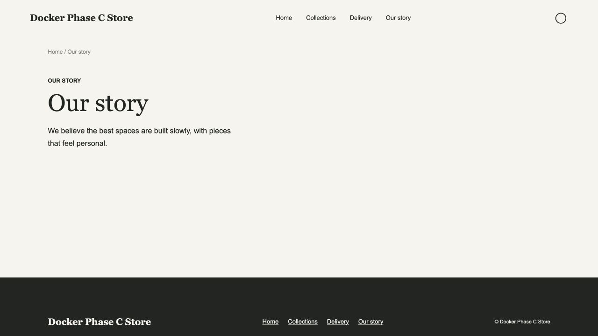

# Storefront 阶段 C 验收

验收日期：2026-10-24（Asia/Shanghai）。

## 范围

- 增量页面：复用已安装蓝图、稳定页面键、Entry 绑定、SEO、区块、导航和下线配置。
- 发布：模型与内容校验、差异、不可变渲染快照、MongoDB CAS 激活、历史与回滚、审计和失败保护。
- 正式路由：首页/集合/商品/内容页只读当前 Release，301、canonical、sitemap 和 no-store。
- 权限：管理员操作、站点归属与域名校验；安装后关闭旧商品直出接口。

## 已通过的验证

| 验证 | 结果 |
| --- | --- |
| 后端完整测试 | 46 通过，1 项数据库测试默认跳过 |
| 后端类型检查 | 通过 |
| Storefront 测试、类型检查、生产构建 | 11 项通过；检查和构建通过 |
| UI 测试、类型检查、生产构建 | 6 项通过；检查和构建通过 |
| 真实 MongoDB + HTTP + Nuxt SSR | 独立运行通过，结束删除随机测试数据库 |
| 完整后端部署生命周期测试 | 通过，使用独立测试数据库 |
| 浏览器交互 | 导入、首发、加页、Entry 绑定、SEO/导航保存、发布差异、正式页面、改路径、历史回滚通过 |
| 独立代码复审 | 无剩余 P1/P2 |
| git diff --check | 通过 |

部署生命周期测试为 `backend/test/storefront-deployment.test.mjs`，覆盖保存 Entry 不改变线上快照、发布后更新、加页发布前 404、发布后 200、SEO/canonical、sitemap、301、下线、过期版本拒绝、回滚、未认证与错误域名拒绝。

## Docker 验收

已完成：实现提交 `d518158` 合并并推送 master；视觉验收补充提交 `0c45877` 修复发布页脚导航间距。

执行 `docker compose -f docker-compose.prod.yml up -d --build` 重建部署。最后的 Storefront 样式修复从独立的 master 工作区重建镜像并重新创建服务，避免并行任务的 D 阶段代码进入镜像。运行中的正式服务和隔离测试容器使用相同镜像：

- Backend：`sha256:bf4e48e706e1109c3dbc3ff2259580c316af10c5e204545c4876c245c114e476`
- Storefront：`sha256:2aa80412f321b5434e8327272c8cc7cd05dd3d7a8ad69b46ec3972a27a3e3a34`

最终镜像上的部署生命周期测试通过，浏览器确认发布历史恢复、导航点击、新增页面及页脚间距。重启隔离 Backend/Storefront 后，当前 Release JSON 与重启前完全一致，新增页面仍返回 200。

现有部署只读检查通过：CMS 健康检查 200、后台入口 200、预制包演示 200；未发布首页仍为 404。保留现有 `cms_db-data`、`cms_uploads`、`cms_backups` 卷，测试发布未写入现有站点数据库。隔离测试容器和本轮创建的测试数据库在验收后清理。

阶段 C 的实施清单与核心验收已全部完成。

## 边界

本阶段只支持一个安装站点、一个配置语言和域名。多域名、访客统计、多站点隔离、主题迁移及 CDN 清理适配器属于后续阶段。快照保留 CMS 图片 URL，媒体文件的保留和备份由运营保障。已有 Sass、Browserslist、Tailwind 和 bundle size 构建警告不阻止构建。
